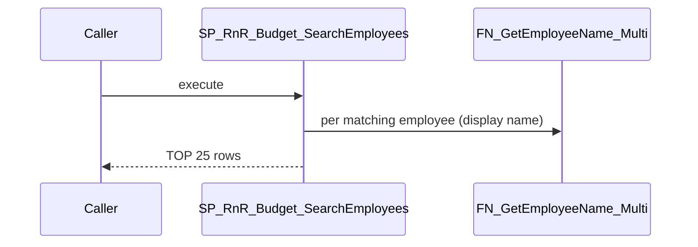
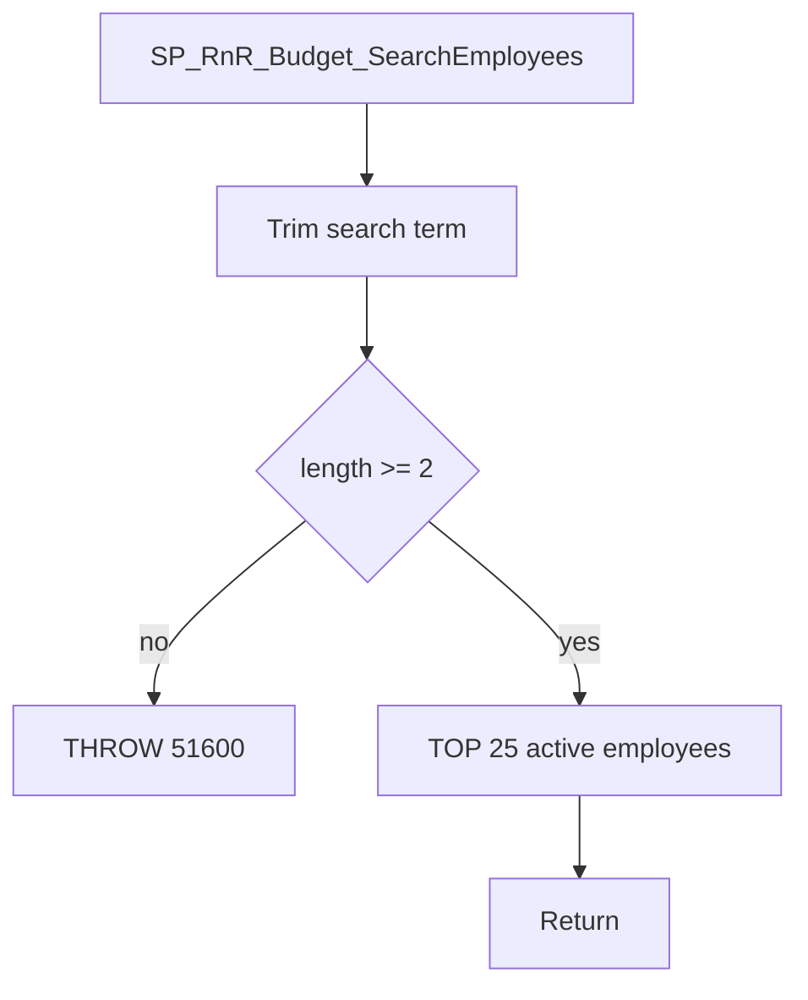

# SP_RnR_Budget_SearchEmployees

## What it does

Recipient typeahead for Give Recognition. Trims `@Search`, requires at least two characters, then returns up to 25 active employees at the employer whose employee id, employment number, or first/last name contain the term. Display name prefers `FN_GetEmployeeName_Multi`, falling back to concatenated `FName` / `LName`. Read-only aside from the name function.

## Parameters

| Name | Direction | What it is for |
|---|---|---|
| `@EmployerId` | in | Employer scope |
| `@Search` | in | Search term. After trim, must be at least two characters |

## Call sequence

## Callers

No other procedure or function in `HRMS-RewardNRecognition/STORED_PROCEDURE` executes this object. App callers live in the Rewards_and_Recognition backend that is not in this SourceCode checkout.

| Object | Kind | Page |
|---|---|---|
| Give Recognition React / RnR API | app | [Give Recognition](/docs/guides/reward-and-recognition/give-recognition) (host only; API not in checkout) |

## Nested

| Object | Kind | When | Page |
|---|---|---|---|
| `FN_GetEmployeeName_Multi` | function | every result row (display name) | [FN_GetEmployeeName_Multi](/docs/database/hrms/FN_GetEmployeeName_Multi) |

## Steps

In `HRMS-DATABASE/HRMS-RewardNRecognition/STORED_PROCEDURE/SP_RnR_Budget_SearchEmployees.sql`:

1. Trim `@Search` into `@Term`.
2. Throw `51600` if length of `@Term` is less than 2.
3. Select top 25 active `TEmployee` rows for the employer joined to `TEmployeeInfo`, matching id, employment number, or concatenated name.
4. Order by `EmployeeId`.

## Tables

| Table | Read or write |
|---|---|
| `dbo.TEmployee` | read |
| `dbo.TEmployeeInfo` | read |

## Flow

