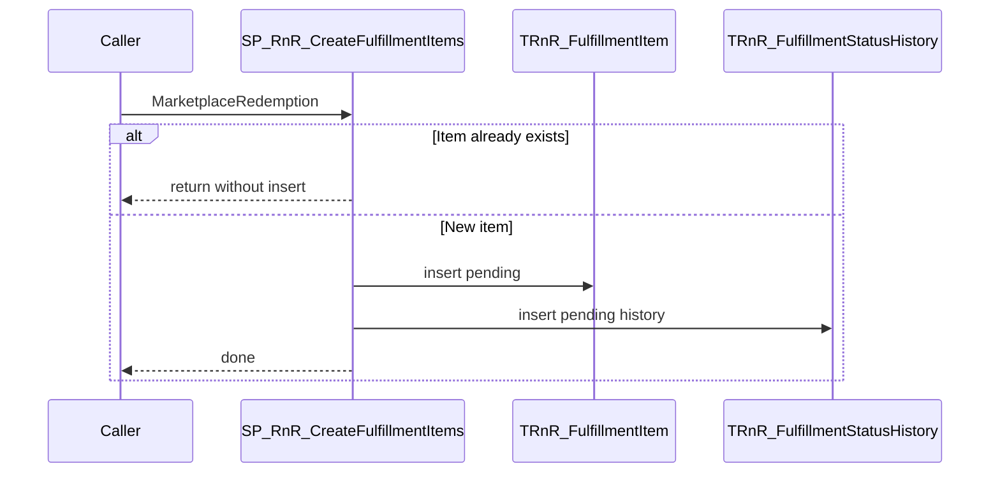
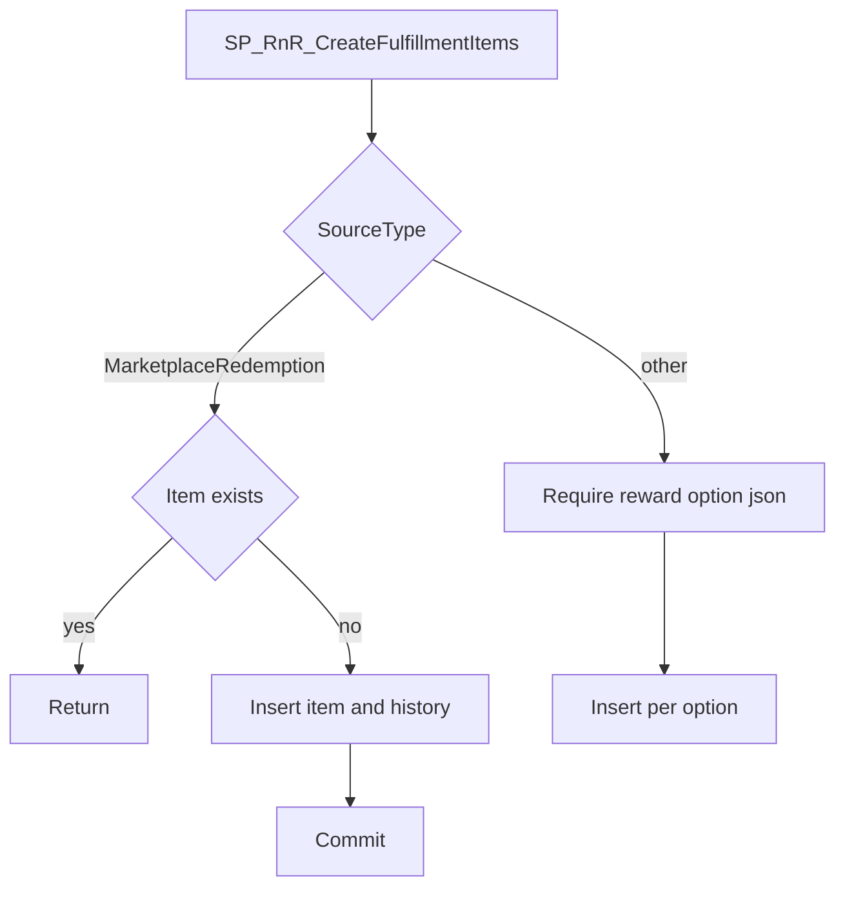

# SP_RnR_CreateFulfillmentItems

## What it does

Creates unified fulfillment queue rows for recognition, marketplace redemption, or jury-award sources. For `@SourceType = 'MarketplaceRedemption'` it idempotently inserts one pending `TRnR_FulfillmentItem` keyed by `source_id` (the redemption activity id) with `@RedemptionTitle` as the display label, plus a status-history row (`Created via marketplace redemption`). Duplicate unique-key races are swallowed. Other source types require `@RewardOptionIdsJson` and insert one item per reward option (not the Marketplace leaf’s primary path). Not executed inside `SP_ProcessRedemption`; the Node API is expected to call it after redeem when fulfillment tracking is needed.

## Parameters

| Name | Direction | What it is for |
|---|---|---|
| `@SourceType` | in | `EmployeeRecognition`, `MarketplaceRedemption`, or `JuryAward` |
| `@SourceId` | in | Source primary key (redemption activity id for Marketplace) |
| `@EmployerId` | in | Employer scope |
| `@RecipientEmployeeId` | in | Employee who receives the reward |
| `@ActorEmployeeId` | in | Actor recorded on status history |
| `@RewardOptionIdsJson` | in | Required for non-Marketplace source types. Default null |
| `@RedemptionTitle` | in | Display label for MarketplaceRedemption items. Default null |

## Call sequence

## Callers

No other procedure or function in `HRMS-RewardNRecognition/STORED_PROCEDURE` executes this object for Marketplace. Nested from auto-approve recognition flows elsewhere; Marketplace path is an app follow-on after `SP_ProcessRedemption`.

| Object | Kind | Page |
|---|---|---|
| Marketplace React / RnR API (follow-on) | app | [Marketplace](/docs/guides/reward-and-recognition/marketplace) (host only; API not in checkout) |
| Give Recognition / recognition create (other source types) | app | [Give Recognition](/docs/guides/reward-and-recognition/give-recognition) |

## Nested

None for the `MarketplaceRedemption` branch (direct inserts only).

## Steps

In `HRMS-DATABASE/HRMS-RewardNRecognition/STORED_PROCEDURE/SP_RnR_CreateFulfillmentItems.sql` (`MarketplaceRedemption` branch):

1. Reject invalid `@SourceType`.
2. Begin transaction; if a `TRnR_FulfillmentItem` already exists for `MarketplaceRedemption` + `@SourceId`, commit and return.
3. Insert pending fulfillment item with null reward_option fields and `@RedemptionTitle` as label.
4. Insert status history from null → pending with actor and note.
5. Commit; on unique-key conflict return quietly; otherwise rollback and throw.

## Tables

| Table | Read or write |
|---|---|
| `dbo.TRnR_FulfillmentItem` | read + write |
| `dbo.TRnR_FulfillmentStatusHistory` | write |
| `dbo.TAwardRewardOptions` | read (non-Marketplace branch only) |

## Flow

