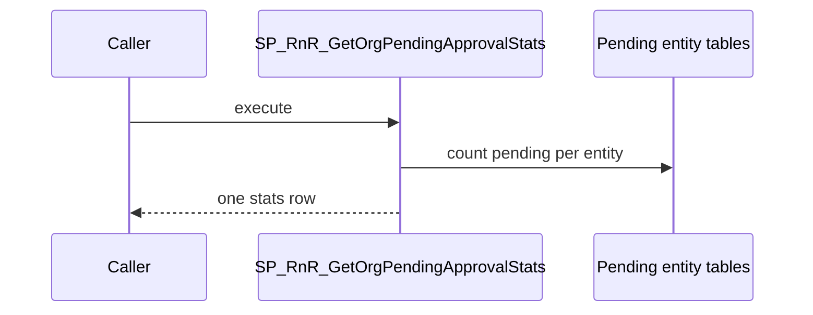
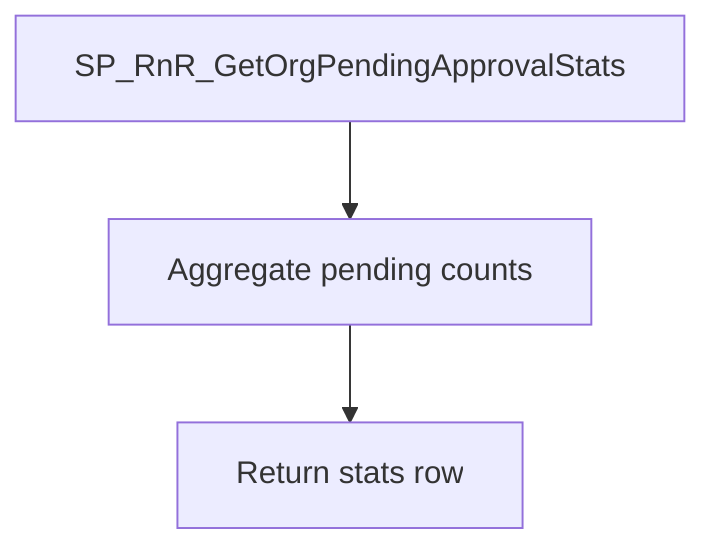

# SP_RnR_GetOrgPendingApprovalStats

## What it does

Returns one row of employer-scoped pending-approval counters for the Notifications / org summary surface: pending employee recognition count and points, oldest pending recognition age in days, and pending counts for jury awards, spotlights, wall of fame, recognition award types, and finance configuration requests.

## Parameters

| Name | Direction | What it is for |
|---|---|---|
| `@EmployerID` | in | Employer scope |

## Call sequence

## Callers

No other procedure or function in `HRMS-RewardNRecognition/STORED_PROCEDURE` executes this object. App callers live in the Rewards_and_Recognition backend that is not in this SourceCode checkout.

| Object | Kind | Page |
|---|---|---|
| Notifications React / RnR API | app | [Notifications](/docs/guides/reward-and-recognition/notifications) (host only; API not in checkout) |

## Nested

None.

## Steps

In `HRMS-DATABASE/HRMS-RewardNRecognition/STORED_PROCEDURE/SP_RnR_GetOrgPendingApprovalStats.sql`:

1. Count `TEmployeeRecognition` with `status = 'pending_approval'`; sum `Points`; compute oldest pending age in days.
2. Count pending jury / spotlight / wall-of-fame / recognition-type rows (`pending_approval`).
3. Count `TFinanceConfigurationRequest` with `Status = 'pending'`.
4. Return the combined scalar columns as one result set.

## Tables

| Table | Read or write |
|---|---|
| `dbo.TEmployeeRecognition` | read |
| `dbo.TJuryAwards` | read |
| `dbo.TEmployeeSpotlights` | read |
| `dbo.TWallOfFame` | read |
| `dbo.TRecognitionAwardTypesMaster` | read |
| `dbo.TFinanceConfigurationRequest` | read |

## Flow

