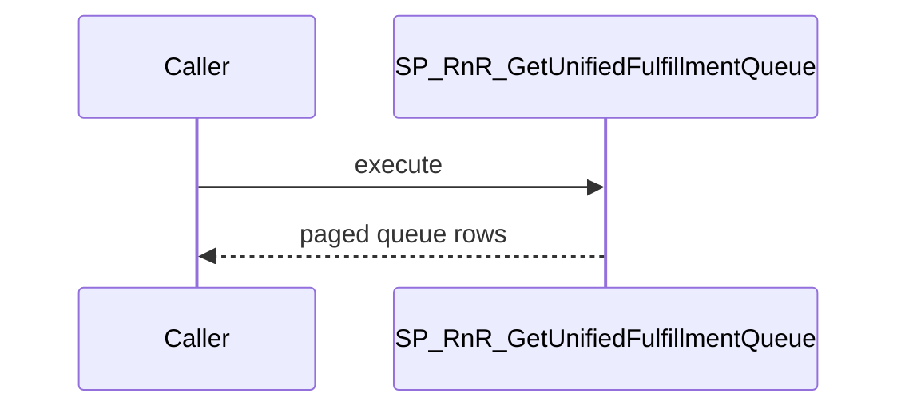
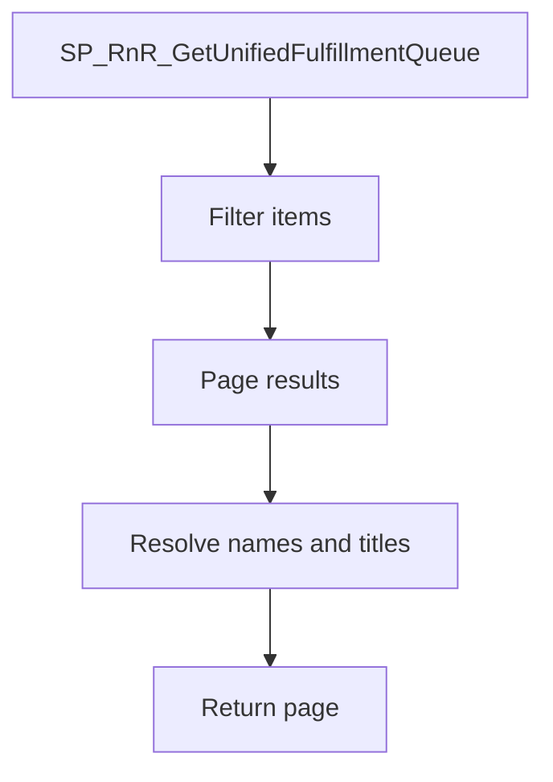

# SP_RnR_GetUnifiedFulfillmentQueue

## What it does

Returns a paged unified fulfillment queue from `TRnR_FulfillmentItem` for an employer, with optional status / source-type / assignee / date filters. Resolves source titles from recognition award types, marketplace redemptions, or jury results, and display names via `Fn_GetEmployeeName` + `TEmployeeInfo`.

## Parameters

| Name | Direction | What it is for |
|---|---|---|
| `@EmployerId` | in | Employer scope |
| `@StatusFilter` | in | Optional fulfillment status |
| `@SourceTypeFilter` | in | Optional source type |
| `@AssignedTo` | in | Optional assignee employee id |
| `@PageNumber` / `@PageSize` | in | Paging (size capped at 100) |
| `@StartDate` / `@EndDate` | in | Optional created_at window |

## Call sequence

## Callers

No other procedure executes this object. App callers: Rewards_and_Recognition `GET /api/v1/fulfillment/admin/queue` → [Admin Console](/docs/guides/reward-and-recognition/admin-console).

## Nested

| Object | Kind | When |
|---|---|---|
| `Fn_GetEmployeeName` | function | per paged recipient / assignee |

## Steps

1. Script is `HRMS-DATABASE/HRMS-RewardNRecognition/STORED_PROCEDURE/SP_RnR_GetUnifiedFulfillmentQueue.sql`.
2. Normalize page number/size.
3. Filter fulfillment items; page oldest-first.
4. Resolve source titles and employee display names for the page only.

## Tables

| Table | Read or write |
|---|---|
| `dbo.TRnR_FulfillmentItem` | read |
| `dbo.TEmployeeRecognition` / `TRecognitionAwardTypesMaster` | read |
| `dbo.TEmployeeRedemptionActivity` / `TRedemptionOption` | read |
| `dbo.TJuryAwardResults` / `TJuryAwards` | read |
| `dbo.TEmployeeInfo` | read |

## Unresolved calls

None.

## Flow

