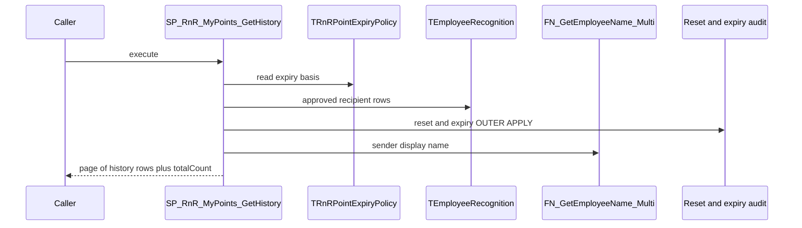
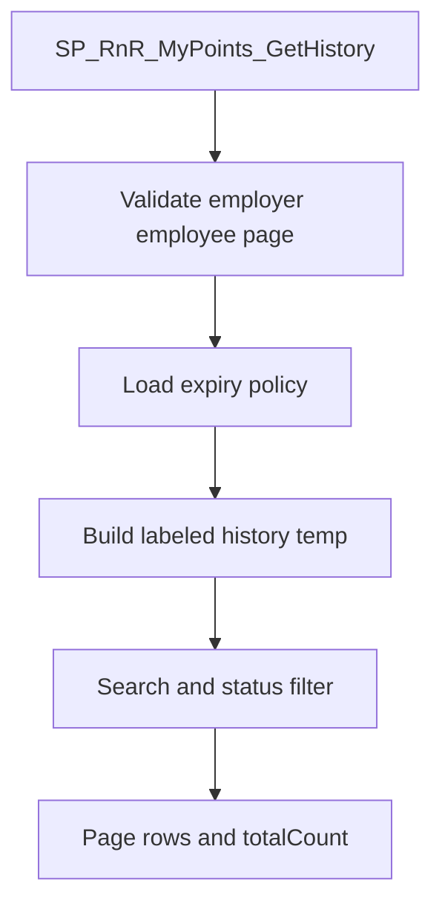

# SP_RnR_MyPoints_GetHistory

## What it does

Returns a paged ledger of approved recognition rows the employee received, with effective remaining / redeemed / expired / carried-forward / available points, status labels (Available, Held, Expiring soon, Redeemed, Expired, reset/wallet variants), key dates, and reset audit fields. Joins award-type display names, point-reset and point-expiry run details, sender employment number, and sender display name via `FN_GetEmployeeName_Multi`. Used by the My Rewards history list.

## Parameters

| Name | Direction | What it is for |
|---|---|---|
| `@EmployerId` | in | Employer scope. Required and greater than 0 |
| `@EmployeeId` | in | Recipient employee. Required and greater than 0 |
| `@Search` | in | Optional search across reason, reset reason, sender name, employment number |
| `@Status` | in | Optional status label filter (`All` / `All statuses` clears filter) |
| `@FromDate` | in | Optional lower bound on recognition `created_at` |
| `@ToDate` | in | Optional upper bound on recognition `created_at` |
| `@PageNumber` | in | Page index (default 1) |
| `@PageSize` | in | Page size (default 20, max 500) |

## Call sequence

## Callers

No other procedure or function in `HRMS-RewardNRecognition/STORED_PROCEDURE` executes this object. App callers live in the Rewards_and_Recognition backend that is not in this SourceCode checkout. `TDataCatalog` lists this procedure among `TRecognitionAwardTypesMaster` consumers.

| Object | Kind | Page |
|---|---|---|
| My Rewards React / RnR API | app | [My Rewards](/docs/guides/reward-and-recognition/my-rewards) (host only; API not in checkout) |

## Nested

| Object | Kind | When | Page |
|---|---|---|---|
| `FN_GetEmployeeName_Multi` | function | sender name on each history row (and search match) | [FN_GetEmployeeName_Multi](/docs/database/hrms/FN_GetEmployeeName_Multi) |

## Steps

In `HRMS-DATABASE/HRMS-RewardNRecognition/STORED_PROCEDURE/SP_RnR_MyPoints_GetHistory.sql`:

1. Throw if `@EmployerId` or `@EmployeeId` is null or not greater than 0; normalize page size/number and status filter.
2. Read `TRnRPointExpiryPolicy`; when basis is `FixedDate`, compute next cut-off.
3. Build `#History` from approved active recipient recognitions joined to award types, reset-run recognition details, latest reset run, and min-holding expiry cuts.
4. Clamp redeemed/expired/reset points; derive remaining, carried-forward, status label, and key-date kind/date from policy and `point_status`.
5. Resolve sender name via `FN_GetEmployeeName_Multi` and employment number from `TEmployeeInfo`; apply search and status filters.
6. Return paged history rows ordered by `earnedOn` / `id` descending, then a second set with `totalCount`.

## Tables

| Table | Read or write |
|---|---|
| `dbo.TRnRPointExpiryPolicy` | read |
| `dbo.TEmployeeRecognition` | read |
| `dbo.TRecognitionAwardTypesMaster` | read |
| `dbo.TRnRPointResetRunRecognition` | read |
| `dbo.TRnRPointResetRun` | read |
| `dbo.TRnRPointExpiryRunEmployee` | read |
| `dbo.TRnRPointExpiryRun` | read |
| `dbo.TEmployeeInfo` | read |

## Unresolved calls

None for named procedure `EXEC`s. Nested function `FN_GetEmployeeName_Multi` is documented above.

## Flow

