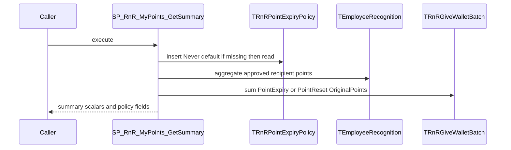
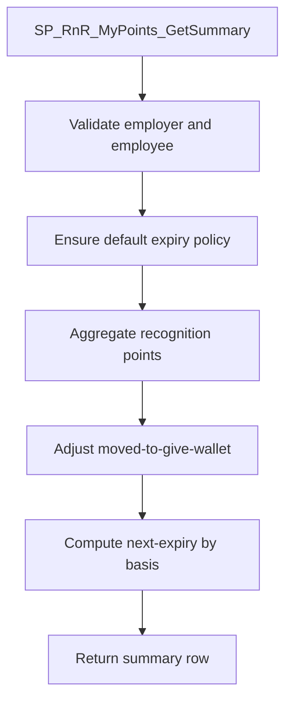

# SP_RnR_MyPoints_GetSummary

## What it does

Returns one summary row for an employee’s approved recognition points at an employer: available balance, earned in an optional date window, expiring within 90 days, cut (expired/reset), redeemed, moved to give wallet, all-time earned, next-expiry hint, and the employer’s point-expiry policy fields (including `showExpiryUi`). Ensures a default `TRnRPointExpiryPolicy` of `Never` exists for the employer before aggregating. Used by the My Rewards leaf balance cards.

## Parameters

| Name | Direction | What it is for |
|---|---|---|
| `@EmployerId` | in | Employer scope. Required and greater than 0 |
| `@EmployeeId` | in | Recipient employee. Required and greater than 0 |
| `@FromDate` | in | Optional lower bound for `earnedThisPeriod` (`created_at`) |
| `@ToDate` | in | Optional upper bound for `earnedThisPeriod` |

## Call sequence

## Callers

No other procedure or function in `HRMS-RewardNRecognition/STORED_PROCEDURE` executes this object. App callers live in the Rewards_and_Recognition backend that is not in this SourceCode checkout.

| Object | Kind | Page |
|---|---|---|
| My Rewards React / RnR API | app | [My Rewards](/docs/guides/reward-and-recognition/my-rewards) (host only; API not in checkout) |

## Nested

None.

## Steps

In `HRMS-DATABASE/HRMS-RewardNRecognition/STORED_PROCEDURE/SP_RnR_MyPoints_GetSummary.sql`:

1. Throw if `@EmployerId` or `@EmployeeId` is null or not greater than 0.
2. If no `TRnRPointExpiryPolicy` row for the employer, insert `ExpiryBasis = Never`.
3. Load policy fields; when basis is `FixedDate`, compute the next cut-off datetime.
4. Aggregate approved active `TEmployeeRecognition` rows for the recipient into available, cut, redeemed, give-wallet moved (from `point_status = wallet`), all-time earned, and period earned.
5. Raise give-wallet moved from `TRnRGiveWalletBatch` (`PointExpiry` / `PointReset`) when that sum is higher, then clamp to cut.
6. Depending on basis (`Rolling`, `MinHoldingPeriod`, `FixedDate`), compute `expiringIn90Days` and next-expiry points/date/days-away.
7. Return one result set of summary scalars plus policy columns and `showExpiryUi`.

## Tables

| Table | Read or write |
|---|---|
| `dbo.TRnRPointExpiryPolicy` | read; write (default insert when missing) |
| `dbo.TEmployeeRecognition` | read |
| `dbo.TRnRGiveWalletBatch` | read |

## Unresolved calls

None.

## Flow

