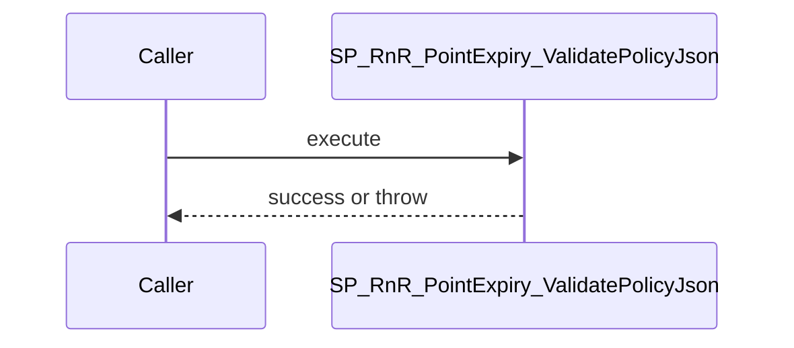
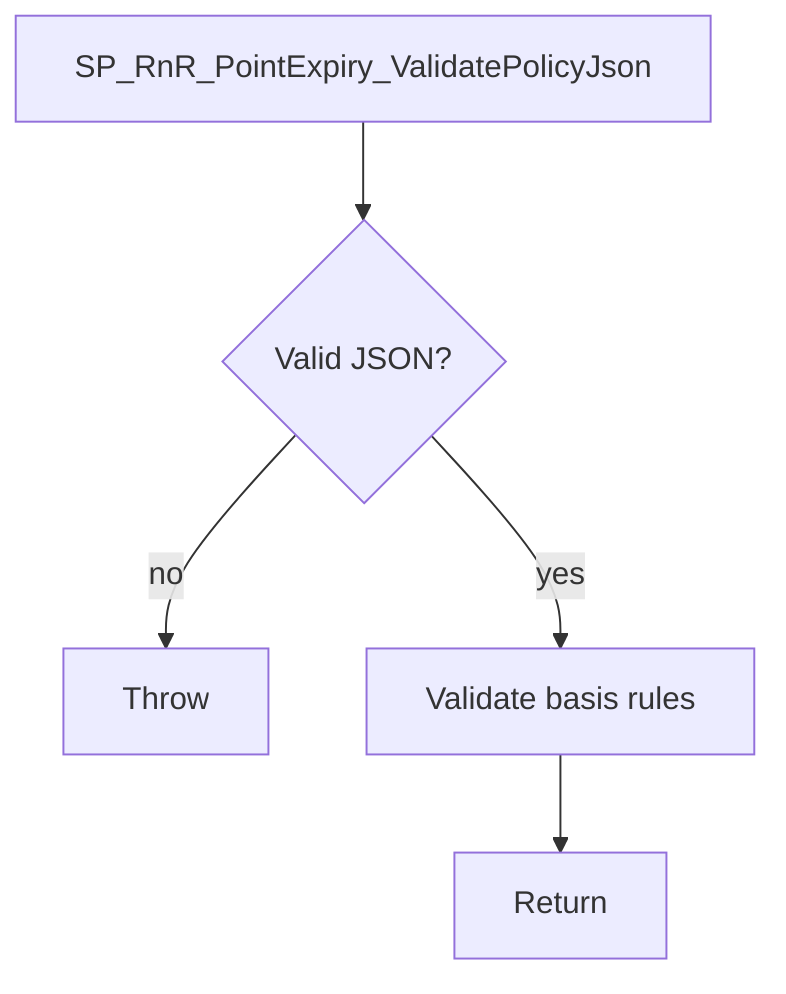

# SP_RnR_PointExpiry_ValidatePolicyJson

## What it does

Validates a point-expiry policy JSON payload (basis Never / Rolling / FixedDate / MinHoldingPeriod and related fields). Throws typed errors on invalid JSON or invalid combinations. Does not write tables.

## Parameters

| Name | Direction | What it is for |
|---|---|---|
| `@PointExpiryPolicyJson` | in | Policy JSON to validate |

## Call sequence

## Callers

Called by `SP_RnR_SaveFinanceConfigurationWithPolicy`. App path is Finance save on [Admin Console](/docs/guides/reward-and-recognition/admin-console).

## Nested

Calls no other procedures or functions.

## Steps

1. Script is `HRMS-DATABASE/HRMS-RewardNRecognition/STORED_PROCEDURE/SP_RnR_PointExpiry_ValidatePolicyJson.sql`.
2. Require valid JSON.
3. Parse basis and related fields; enforce allowed enums and combinations per basis.
4. Throw on invalid policy; otherwise return.

## Tables

None.

## Unresolved calls

None.

## Flow

