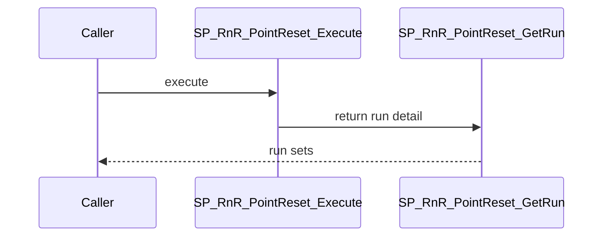
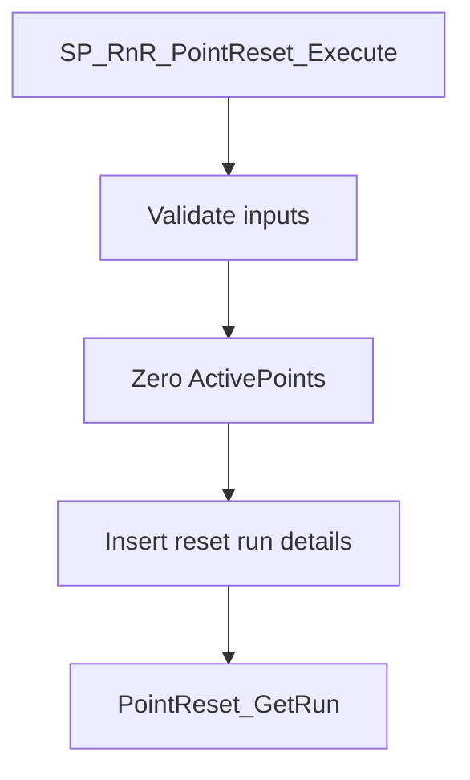

# SP_RnR_PointReset_Execute

## What it does

Executes a point reset for selected employees: zeros approved recognition `ActivePoints`, records reset run / employee / recognition detail rows, optionally routes cut points to organisation pool or give wallet based on `@ActionType`, and returns the run via `SP_RnR_PointReset_GetRun`. Requires a non-empty reason and at least one employee with active points.

## Parameters

| Name | Direction | What it is for |
|---|---|---|
| `@EmployerId` | in | Employer scope |
| `@SelectionMode` | in | `Filter` or `Individual` |
| `@AppliedToJson` | in | Selection criteria JSON |
| `@EmployeeIdsJson` | in | Employee id JSON array |
| `@ActionType` | in | `Expired` / `OrganisationPool` / `GiveWallet` |
| `@Reason` | in | Mandatory reason |
| `@NotifyAffected` | in | Whether to notify |
| `@RunBy` | in | Acting user |

## Call sequence

## Callers

No other procedure executes this object. App callers: Admin Console Point Reset execute.

## Nested

| Object | Kind | When |
|---|---|---|
| `SP_RnR_PointReset_GetRun` | procedure | always after successful run |

## Steps

1. Script is `HRMS-DATABASE/HRMS-RewardNRecognition/STORED_PROCEDURE/SP_RnR_PointReset_Execute.sql`.
2. Validate mode, action, reason, and JSON payloads.
3. If GiveWallet requested but Budget Control off, coerce action to OrganisationPool.
4. Zero active points on selected approved recognitions; abort if none.
5. Insert reset run and detail rows; apply pool/wallet side effects for non-Expired actions as implemented in the remainder of the script.
6. Execute `SP_RnR_PointReset_GetRun`.

## Tables

| Table | Read or write |
|---|---|
| `dbo.TRnRBudgetConfiguration` | read |
| `dbo.TEmployeeRecognition` | write |
| `dbo.TRnRPointResetRun` | write |
| `dbo.TRnRPointResetRunEmployee` | write |
| `dbo.TRnRPointResetRunRecognition` | write |

## Unresolved calls

None at one nested level.

## Flow

