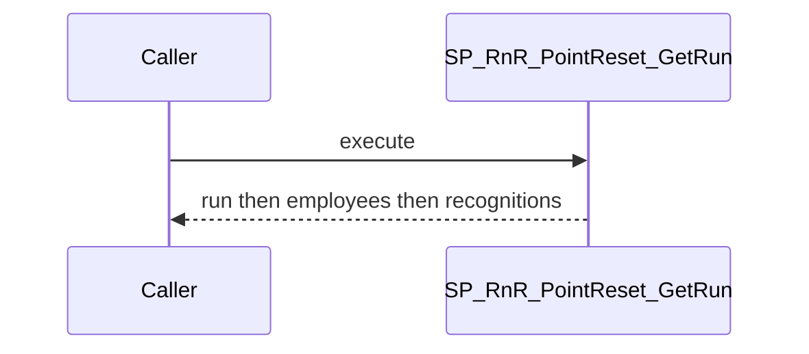
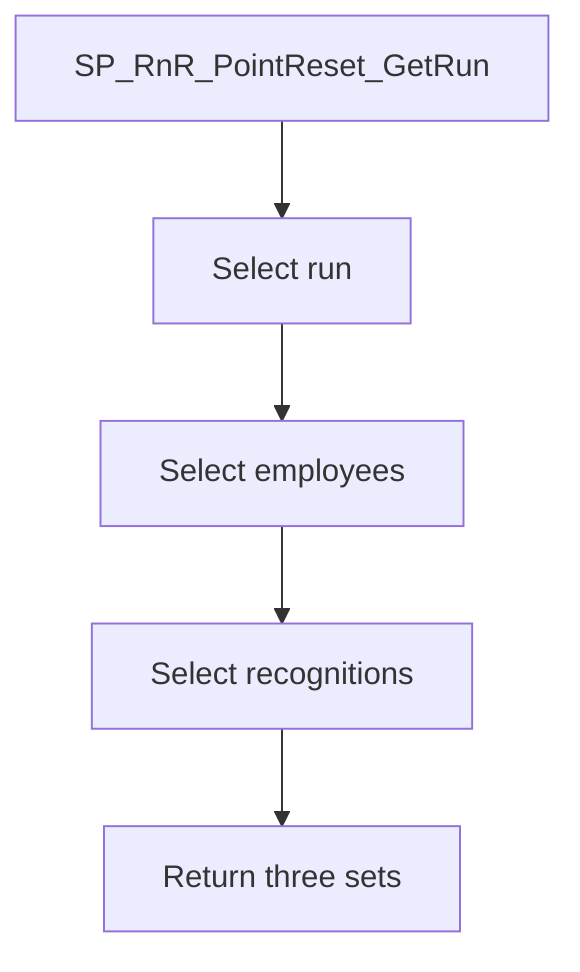

# SP_RnR_PointReset_GetRun

## What it does

Returns three result sets for one point-reset run: run header, per-employee totals, and per-recognition cut detail.

## Parameters

| Name | Direction | What it is for |
|---|---|---|
| `@EmployerId` | in | Employer scope |
| `@ResetRunId` | in | Run id |

## Call sequence

## Callers

Called by `SP_RnR_PointReset_Execute`. Also usable as a direct run-detail read from [Admin Console](/docs/guides/reward-and-recognition/admin-console).

## Nested

Calls no other procedures or functions.

## Steps

1. Script is `HRMS-DATABASE/HRMS-RewardNRecognition/STORED_PROCEDURE/SP_RnR_PointReset_GetRun.sql`.
2. Select run header from `TRnRPointResetRun`.
3. Select employee rows ordered by EmployeeId.
4. Select recognition detail rows ordered by employee then recognition.

## Tables

| Table | Read or write |
|---|---|
| `dbo.TRnRPointResetRun` | read |
| `dbo.TRnRPointResetRunEmployee` | read |
| `dbo.TRnRPointResetRunRecognition` | read |

## Unresolved calls

None.

## Flow

