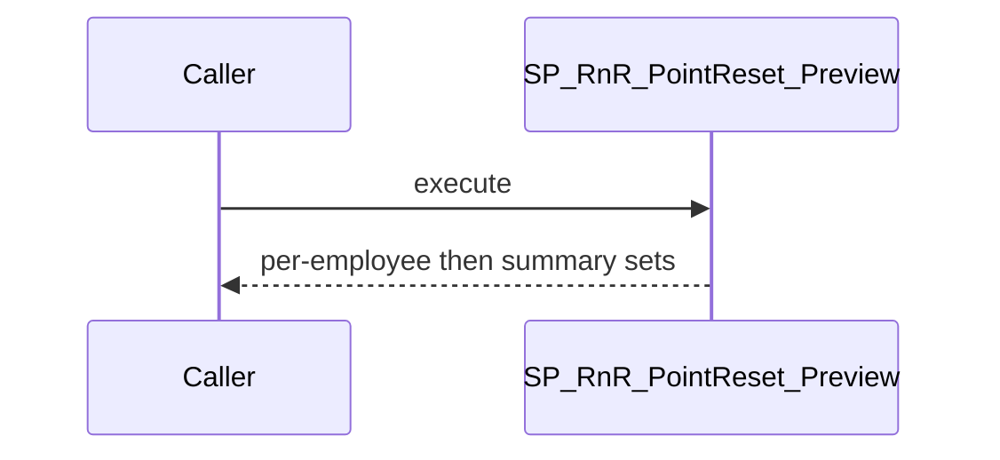
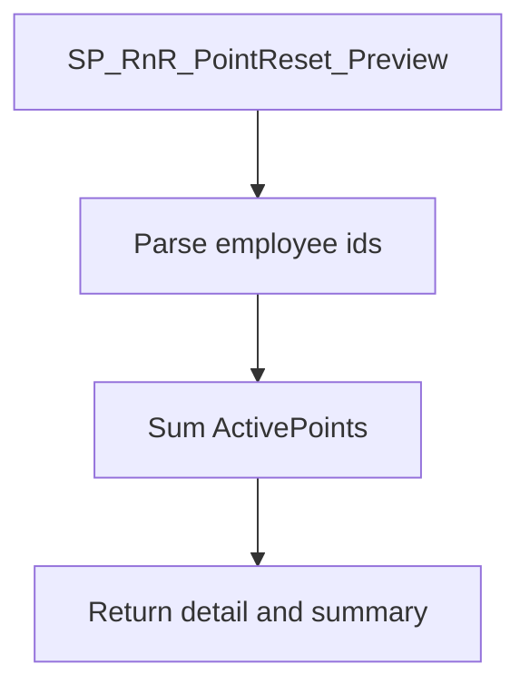

# SP_RnR_PointReset_Preview

## What it does

Previews how many approved `ActivePoints` would be reset for a JSON list of employees: per-employee totals, then a summary employee count and points total. Does not mutate data.

## Parameters

| Name | Direction | What it is for |
|---|---|---|
| `@EmployerId` | in | Employer scope |
| `@EmployeeIdsJson` | in | JSON array of employee ids |

## Call sequence

## Callers

No other procedure executes this object. App callers: Admin Console Point Reset preview.

## Nested

Calls no other procedures or functions.

## Steps

1. Script is `HRMS-DATABASE/HRMS-RewardNRecognition/STORED_PROCEDURE/SP_RnR_PointReset_Preview.sql`.
2. Require valid JSON employee array.
3. Aggregate `ActivePoints` from approved recognitions per employee.
4. Return detail set then summary set.

## Tables

| Table | Read or write |
|---|---|
| `dbo.TEmployeeRecognition` | read |

## Unresolved calls

None.

## Flow

