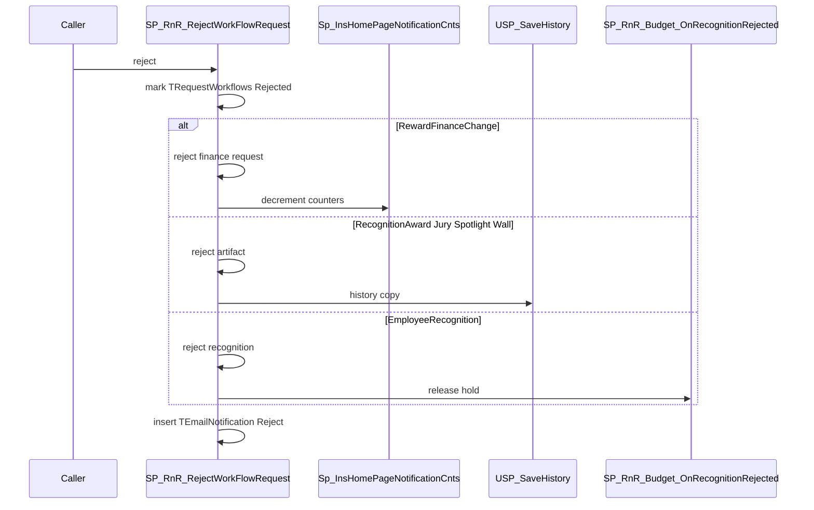
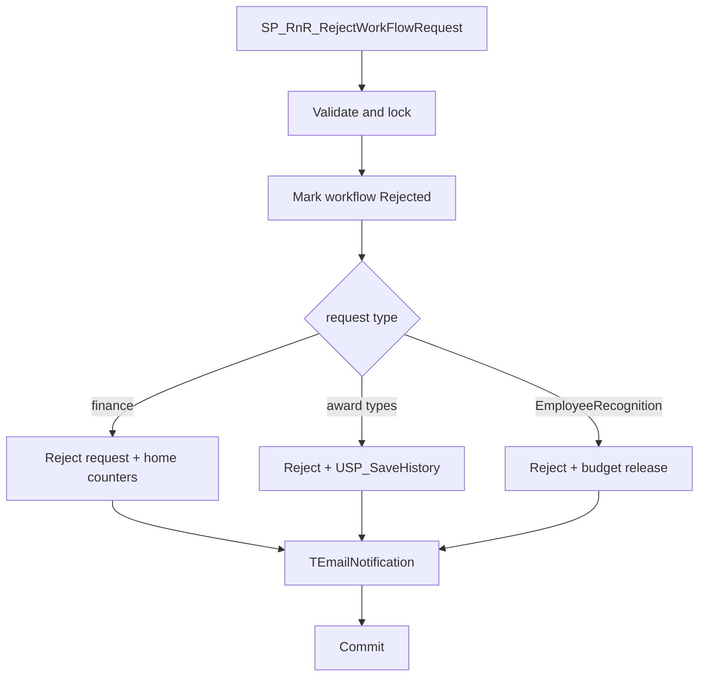

# SP_RnR_RejectWorkFlowRequest

## What it does

Rejects the current pending RnR workflow level for `@RequestType` / `@RequestTransId` / `@EmployeeId`. Sets matching `TRequestWorkflows` rows to `ApproveStatus = 'R'`, flips the request artifact to rejected with reason/audit columns, adjusts home-page counters for finance rejects, copies history via `USP_SaveHistory` for several award types, and for **EmployeeRecognition** releases budget holds through `SP_RnR_Budget_OnRecognitionRejected`. Seeds a reject `TEmailNotification` row. Runs in one transaction with `SET XACT_ABORT ON`.

## Parameters

| Name | Direction | What it is for |
|---|---|---|
| `@RequestType` | in | Workflow request type (same family as approve) |
| `@RequestTransId` | in | Artifact primary key / request id |
| `@RejectionReason` | in | Comment stored on workflow and artifact |
| `@EmployeeId` | in | Acting rejector |
| `@Employerid` | in | Employer scope |

## Call sequence

## Callers

No other procedure in `HRMS-RewardNRecognition/STORED_PROCEDURE` executes this object (backup scripts are separate). App callers live in the Rewards_and_Recognition backend that is not in this SourceCode checkout.

| Object | Kind | Page |
|---|---|---|
| Notifications React / RnR API | app | [Notifications](/docs/guides/reward-and-recognition/notifications) (host only; API not in checkout) |

## Nested

| Object | Kind | When | Page |
|---|---|---|---|
| `Sp_InsHomePageNotificationCnts` | procedure | finance reject counter delta | [Sp_InsHomePageNotificationCnts](/docs/database/hrms/Sp_InsHomePageNotificationCnts) |
| `USP_SaveHistory` | procedure (RnR synonym → HRMS) | RecognitionAward / Jury / Spotlight / Wall reject | Synonym only — no baseline CREATE page |
| `SP_RnR_Budget_OnRecognitionRejected` | procedure | EmployeeRecognition reject | [SP_RnR_Budget_OnRecognitionRejected](/docs/database/hrms-rewardnrecognition/SP_RnR_Budget_OnRecognitionRejected) |
| `FN_GetEmployeeName_Multi` | function | custom status text | [FN_GetEmployeeName_Multi](/docs/database/hrms/FN_GetEmployeeName_Multi) |
| `Fn_GetHomePageNotificationIdByRequestType` | function | home notification id | [Fn_GetHomePageNotificationIdByRequestType](/docs/database/hrms/Fn_GetHomePageNotificationIdByRequestType) |

## Steps

In `HRMS-DATABASE/HRMS-RewardNRecognition/STORED_PROCEDURE/SP_RnR_RejectWorkFlowRequest.sql`:

1. Begin transaction; for EmployeeRecognition, lock and require pending recognition + pending workflow for this manager.
2. Load workflow id / level; resolve home-page notification id.
3. Update current-level workflow rows to Rejected for this manager and peers still pending at the level.
4. Type-specific reject updates and history / counter / budget nested calls as in the sequence diagram.
5. Insert `TEmailNotification` with ActionName `Reject`.
6. Commit; on error rollback and throw.

## Tables

| Table | Read or write |
|---|---|
| `dbo.TRequestWorkflows` | read / write |
| `dbo.TFinanceConfigurationRequest` | read / write |
| `dbo.TFinanceConfigurationRequestStatusHistory` | write |
| `dbo.TRecognitionAwardTypesMaster` | read / write |
| `dbo.TJuryAwards` | read / write |
| `dbo.TEmployeeSpotlights` | read / write |
| `dbo.TWallOfFame` | read / write |
| `dbo.TEmployeeRecognition` | read / write |
| `dbo.TEmployeeRecognitionStatusHistory` | write |
| `dbo.TEmailNotification` | write |

## Unresolved calls

`USP_SaveHistory` body is not inventoried as a baseline CREATE script in this workspace (RnR synonym to HRMS).

## Flow

