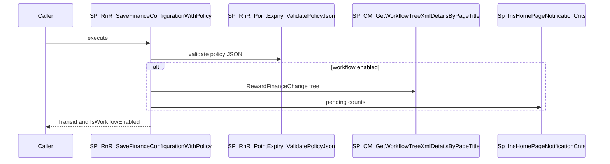
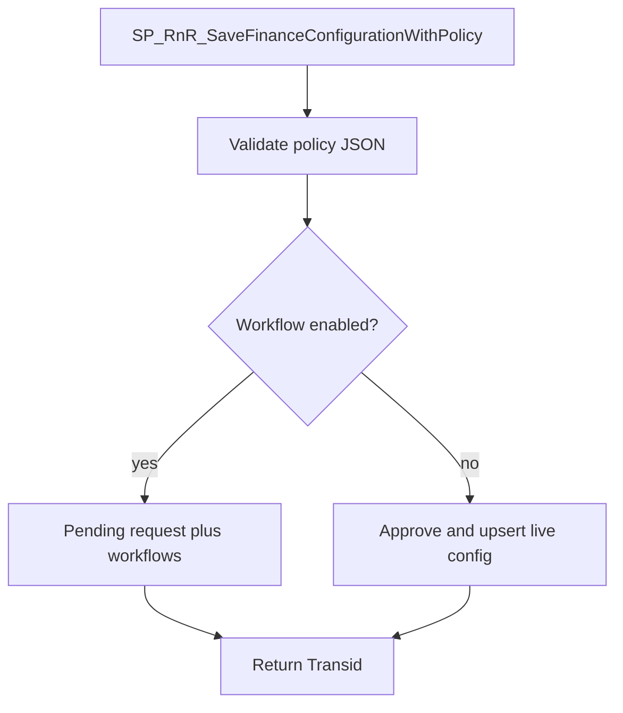

# SP_RnR_SaveFinanceConfigurationWithPolicy

## What it does

Submits a finance configuration change including point-expiry policy JSON. Validates policy first. When `RewardFinanceChange` workflow is on, inserts a Pending `TFinanceConfigurationRequest` with workflows, email, and home-page notifications (blocks if another Pending exists). When workflow is off, auto-approves the request and upserts live `TFinanceConfiguration`. Returns `Transid` and whether workflow was enabled.

## Parameters

| Name | Direction | What it is for |
|---|---|---|
| `@EmployerId` | in | Employer scope |
| `@Currency` | in | Currency code |
| `@PointToCurrencyRate` | in | Points-to-currency rate |
| `@PointsExpiryDays` | in | Legacy expiry days field |
| `@MinPointsAward` / `@MaxPointsAward` | in | Award bounds |
| `@PointExpiryPolicyJson` | in | Point expiry policy JSON |
| `@UserId` | in | Acting user |

## Call sequence

## Callers

No other procedure executes this object. App callers: Rewards_and_Recognition finance admin save → [Admin Console](/docs/guides/reward-and-recognition/admin-console).

## Nested

| Object | Kind | When |
|---|---|---|
| `SP_RnR_PointExpiry_ValidatePolicyJson` | procedure | always |
| `SP_CM_GetWorkflowTreeXmlDetailsByPageTitle` | procedure | workflow on |
| `SP_CM_GetDataforRequestWorkFlows` | procedure | workflow on |
| `SP_CM_GetDataForEmailNotification` | procedure | workflow on |
| `Sp_InsHomePageNotificationCnts` | procedure | workflow on |
| `FN_CM_GetMgrFromRequestWorkflows` / `FN_GetEmployeeName_Multi` / `FN_CM_GetApproverList` | function | workflow on |
| `Fn_GetHomePageNotificationIdByRequestType` | function | always (notification id) |

## Steps

1. Script is `HRMS-DATABASE/HRMS-RewardNRecognition/STORED_PROCEDURE/SP_RnR_SaveFinanceConfigurationWithPolicy.sql`.
2. Validate policy JSON.
3. Read workflow toggle; if on and a Pending request exists, throw.
4. Insert request + status history.
5. Workflow on → workflows, email, home-page notification; workflow off → approve request and upsert `TFinanceConfiguration`.
6. Return `Transid` and `IsWorkflowEnabled`.

## Tables

| Table | Read or write |
|---|---|
| `dbo.TRnR_WorkflowConfiguration` | read |
| `dbo.TFinanceConfigurationRequest` | read/write |
| `dbo.TFinanceConfigurationRequestStatusHistory` | write |
| `dbo.TRequestWorkflows` | write when workflow on |
| `dbo.TEmailNotification` | write when workflow on |
| `dbo.TFinanceConfiguration` | write when workflow off |

## Unresolved calls

None among nested objects with pages (or HRMS pages already present).

## Flow

