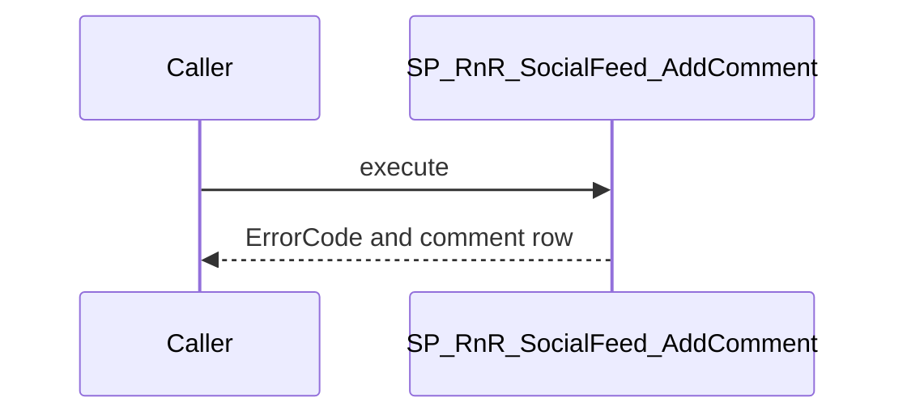
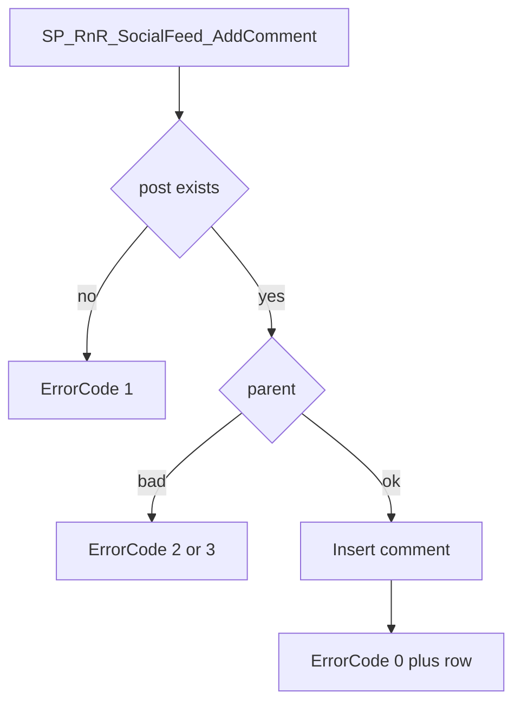

# SP_RnR_SocialFeed_AddComment

## What it does

Adds a top-level comment or reply. Verifies the post exists for the employer. For replies, loads parent Depth and rejects missing parent (ErrorCode 2) or parent Depth >= 2 (ErrorCode 3). Inserts the comment and returns ErrorCode 0 plus the new comment row.

## Parameters

| Name | Direction | What it is for |
|---|---|---|
| `@EmployerId` | in | Employer scope |
| `@PostId` | in | Target post |
| `@EmployeeId` | in | Comment author |
| `@Body` | in | Comment text (API caps length) |
| `@ParentCommentId` | in | Optional parent for reply |

## Call sequence

## Callers

No other procedure executes this object. App caller: RnR `POST /api/v1/social-feed/:postId/comments` from [Social Feed](/docs/guides/reward-and-recognition/social-feed).

## Nested

Calls no other procedures or functions.

## Steps

1. If post missing for employer, return ErrorCode 1.
2. If parent provided, resolve Depth; ErrorCode 2/3 on bad/deep parent; set Depth = parent+1.
3. INSERT TRnR_SocialPostComment; return ErrorCode 0 and new comment projection.

## Tables

| Table | Read or write |
|---|---|
| `dbo.TRnR_SocialPost` | read |
| `dbo.TRnR_SocialPostComment` | read/write |
| `dbo.TEmployee` | read |

## Unresolved calls

None.

## Flow

