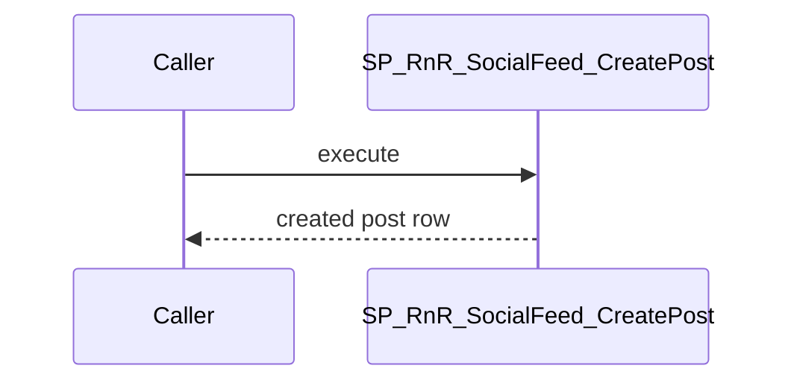
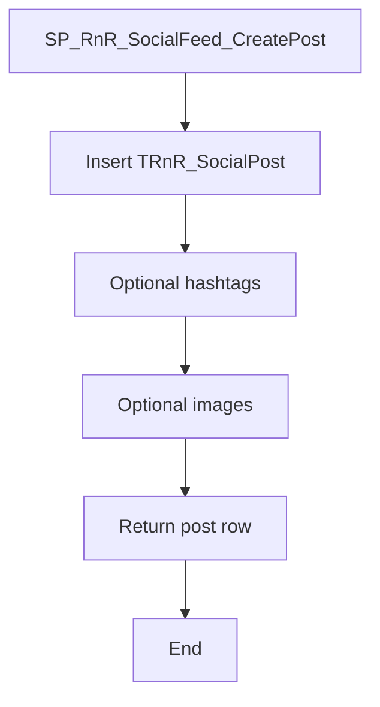

# SP_RnR_SocialFeed_CreatePost

## What it does

Inserts a new social post for an employer/employee, optionally inserts hashtag and image URL rows from JSON arrays, then returns the created post with camelCase aliases and a concatenated imageUrls string.

## Parameters

| Name | Direction | What it is for |
|---|---|---|
| `@EmployerId` | in | Employer scope |
| `@EmployeeId` | in | Author employee id |
| `@PostType` | in | Post type (e.g. employee) |
| `@Badge` | in | Optional badge text |
| `@Title` | in | Optional title |
| `@Body` | in | Post body |
| `@AuthorBusinessUnitId` | in | Optional author BU |
| `@HashtagsJson` | in | Optional JSON array of tags |
| `@ImageUrlsJson` | in | Optional JSON array of image URLs (max 5 intended by API) |
| `@CreatedAtUtc` | in | Optional created timestamp; default GETUTCDATE() |

## Call sequence

## Callers

No other procedure executes this object. App caller: RnR `POST /api/v1/social-feed` from [Social Feed](/docs/guides/reward-and-recognition/social-feed).

## Nested

Calls no other procedures or functions.

## Steps

1. Insert into TRnR_SocialPost and capture SCOPE_IDENTITY as @PostId.
2. When @HashtagsJson is valid JSON, insert tags into TRnR_SocialPostHashtag.
3. When @ImageUrlsJson is valid JSON, insert ImageUrl/SortOrder into TRnR_SocialPostImage.
4. Select the new post joined to TEmployee for authorName and STRING_AGG image URLs.

## Tables

| Table | Read or write |
|---|---|
| `dbo.TRnR_SocialPost` | write |
| `dbo.TRnR_SocialPostHashtag` | write |
| `dbo.TRnR_SocialPostImage` | write |
| `dbo.TEmployee` | read |

## Unresolved calls

None.

## Flow

