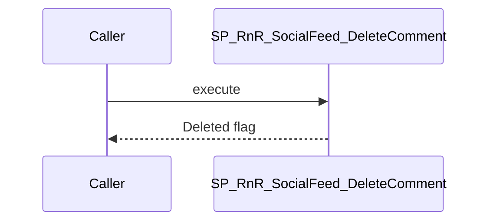
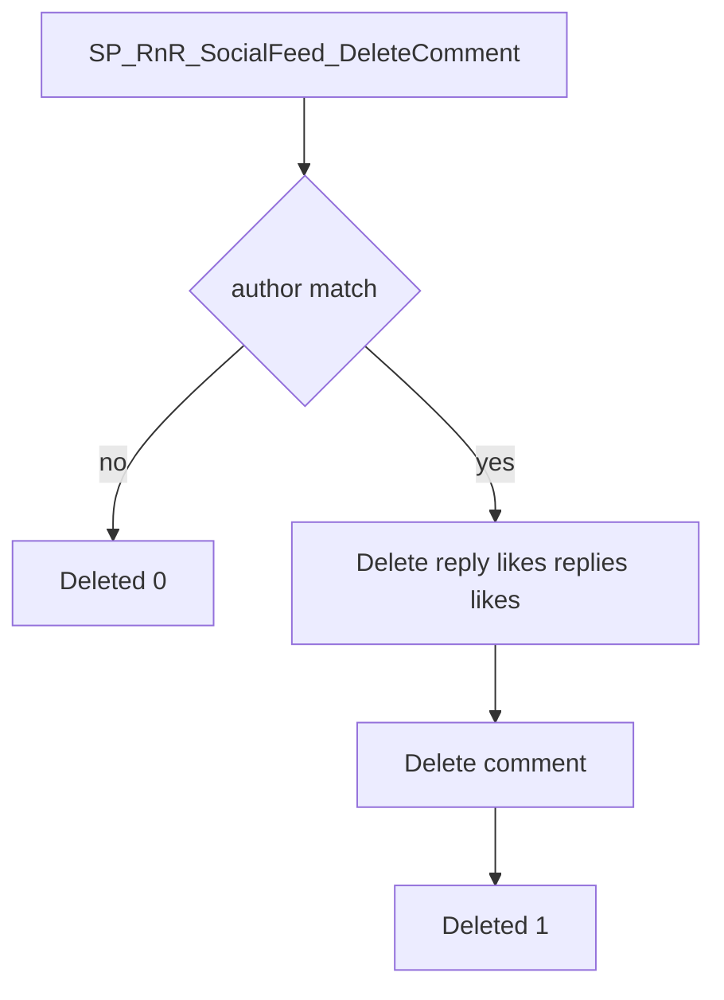

# SP_RnR_SocialFeed_DeleteComment

## What it does

Hard-deletes a comment authored by the caller on an employer post. Also deletes likes on replies, reply comments, likes on the comment, then the comment. Returns Deleted=0 when ownership fails, else Deleted=1.

## Parameters

| Name | Direction | What it is for |
|---|---|---|
| `@EmployerId` | in | Employer scope |
| `@CommentId` | in | Comment to delete |
| `@EmployeeId` | in | Must be comment author |

## Call sequence

## Callers

No other procedure executes this object. App caller: RnR `DELETE /api/v1/social-feed/:postId/comments/:commentId` from [Social Feed](/docs/guides/reward-and-recognition/social-feed).

## Nested

Calls no other procedures or functions.

## Steps

1. Verify comment belongs to employer post and @EmployeeId; else Deleted=0.
2. DELETE likes on replies, then reply comments, then likes on the comment, then the comment.
3. Return Deleted=1.

## Tables

| Table | Read or write |
|---|---|
| `dbo.TRnR_SocialPost` | read |
| `dbo.TRnR_SocialPostComment` | write |
| `dbo.TRnR_SocialPostCommentLike` | write |

## Unresolved calls

None.

## Flow

