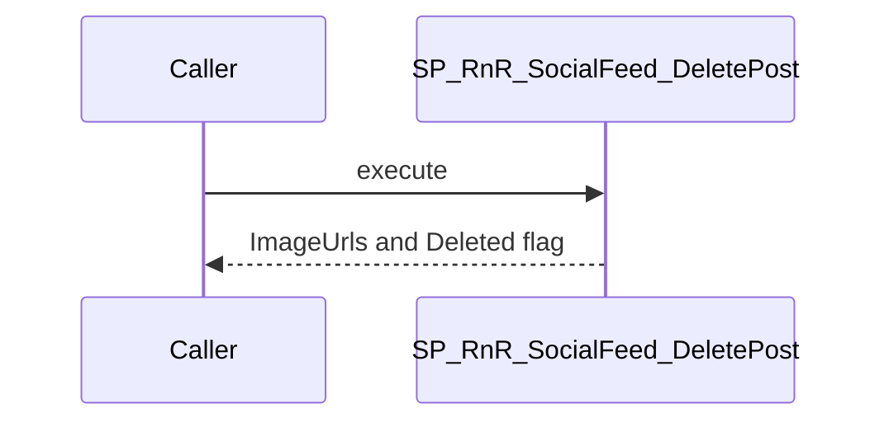
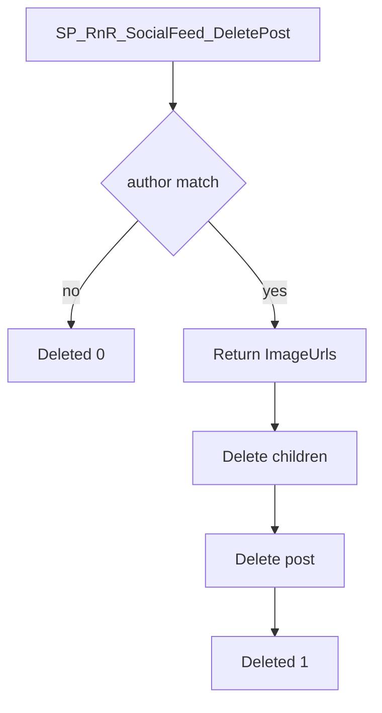

# SP_RnR_SocialFeed_DeletePost

## What it does

Author-scoped hard delete. If the post does not belong to the employer/author, returns an empty ImageUrl set and Deleted=0. Otherwise returns image URLs, deletes comment likes, comments, reactions, hashtags, and images, then deletes the post and returns Deleted=1.

## Parameters

| Name | Direction | What it is for |
|---|---|---|
| `@EmployerId` | in | Employer scope |
| `@PostId` | in | Post to delete |
| `@EmployeeId` | in | Author employee id |

## Call sequence

## Callers

No other procedure executes this object. App caller: RnR `DELETE /api/v1/social-feed/:postId` from [Social Feed](/docs/guides/reward-and-recognition/social-feed).

## Nested

Calls no other procedures or functions.

## Steps

1. Verify PostId + EmployerId + EmployeeId; on miss return empty images and Deleted=0.
2. Select ImageUrl rows for the post (for app blob cleanup).
3. DELETE comment likes for comments on the post, then comments, likes, hashtags, images.
4. DELETE the post row; return Deleted=1.

## Tables

| Table | Read or write |
|---|---|
| `dbo.TRnR_SocialPost` | write |
| `dbo.TRnR_SocialPostImage` | write |
| `dbo.TRnR_SocialPostHashtag` | write |
| `dbo.TRnR_SocialPostLike` | write |
| `dbo.TRnR_SocialPostComment` | write |
| `dbo.TRnR_SocialPostCommentLike` | write |

## Unresolved calls

None.

## Flow

