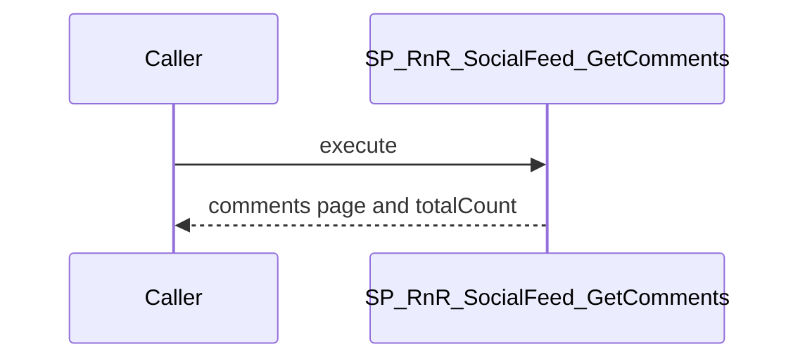
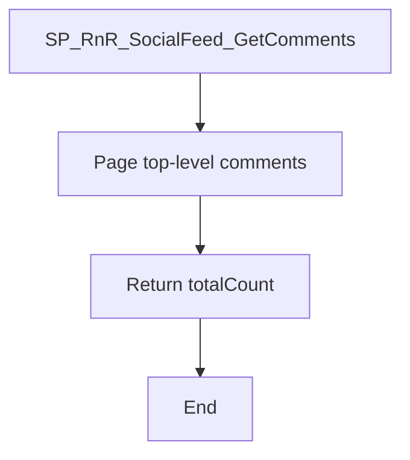

# SP_RnR_SocialFeed_GetComments

## What it does

Returns cursor-paged top-level comments for an active employer post (newest first) with author name, likeCount, userLiked, replyCount, and depth, plus a second result set with totalCount of top-level comments.

## Parameters

| Name | Direction | What it is for |
|---|---|---|
| `@EmployerId` | in | Employer scope |
| `@PostId` | in | Post whose comments are listed |
| `@EmployeeId` | in | Optional caller for userLiked |
| `@PageSize` | in | Page size (default 20) |
| `@LastCommentId` | in | Cursor - return CommentId less than this |

## Call sequence

## Callers

No other procedure executes this object. App caller: RnR `GET /api/v1/social-feed/:postId/comments` from [Social Feed](/docs/guides/reward-and-recognition/social-feed).

## Nested

Calls no other procedures or functions.

## Steps

1. Select top-level active comments joined to active employer post, with like/reply aggregates and TEmployee name.
2. Apply @LastCommentId cursor and FETCH NEXT @PageSize.
3. Return totalCount of top-level active comments for the post.

## Tables

| Table | Read or write |
|---|---|
| `dbo.TRnR_SocialPost` | read |
| `dbo.TRnR_SocialPostComment` | read |
| `dbo.TRnR_SocialPostCommentLike` | read |
| `dbo.TEmployee` | read |

## Unresolved calls

None.

## Flow

