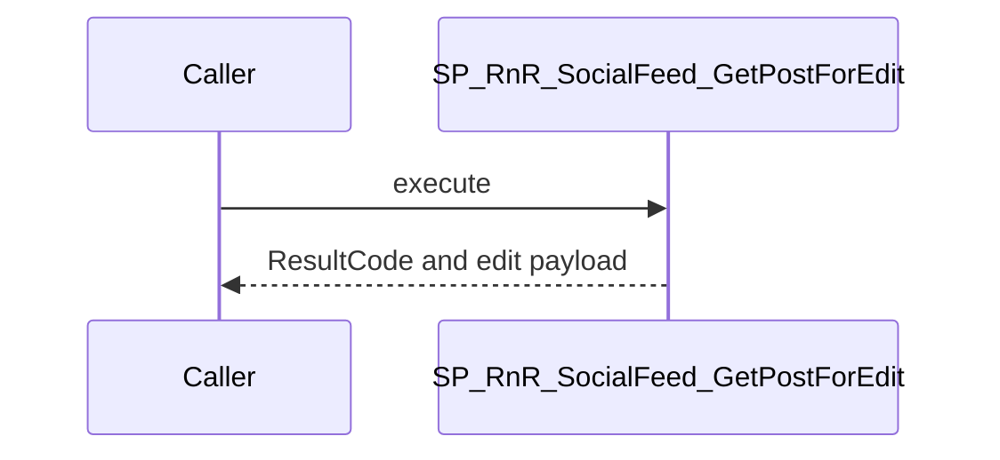
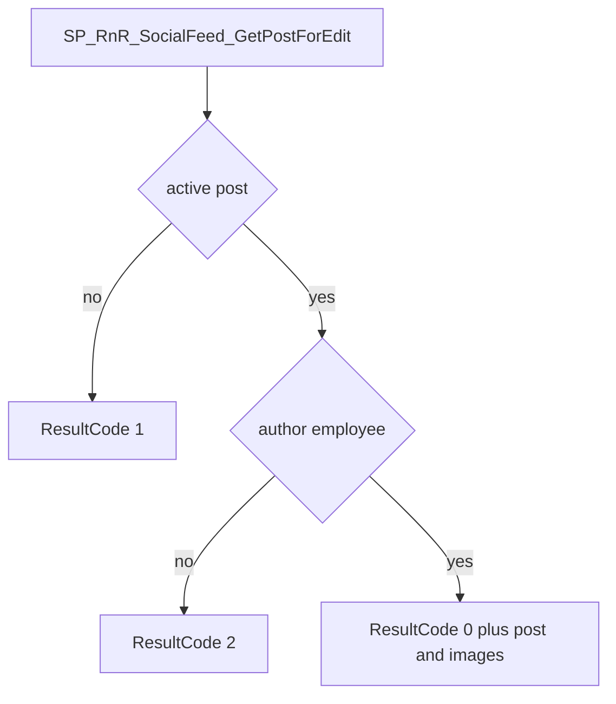

# SP_RnR_SocialFeed_GetPostForEdit

## What it does

Author-only edit loader. Returns ResultCode 1 if the post is missing/inactive for the employer, 2 if the caller is not the employee author of an active employee post, otherwise ResultCode 0 plus the post Body/ModifiedAt/RowVersion and the image list ordered by SortOrder.

## Parameters

| Name | Direction | What it is for |
|---|---|---|
| `@EmployerId` | in | Employer scope |
| `@PostId` | in | Post to edit |
| `@EmployeeId` | in | Caller must be author |

## Call sequence

## Callers

No other procedure executes this object. App caller: RnR `GET /api/v1/social-feed/:postId/edit` from [Social Feed](/docs/guides/reward-and-recognition/social-feed).

## Nested

Calls no other procedures or functions.

## Steps

1. If no active post for employer/PostId, return ResultCode 1.
2. If post is not owned by @EmployeeId with PostType employee, return ResultCode 2.
3. Return ResultCode 0, then post edit columns, then image rows.

## Tables

| Table | Read or write |
|---|---|
| `dbo.TRnR_SocialPost` | read |
| `dbo.TRnR_SocialPostImage` | read |

## Unresolved calls

None.

## Flow

