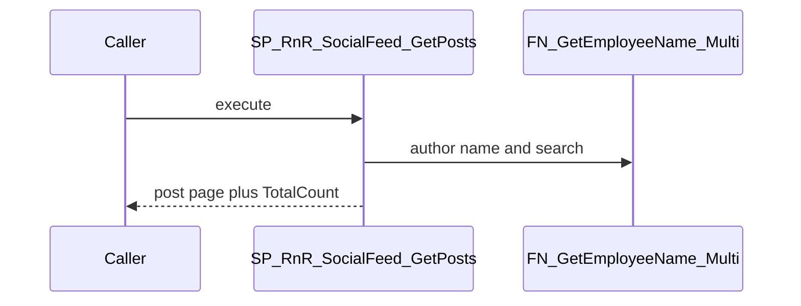
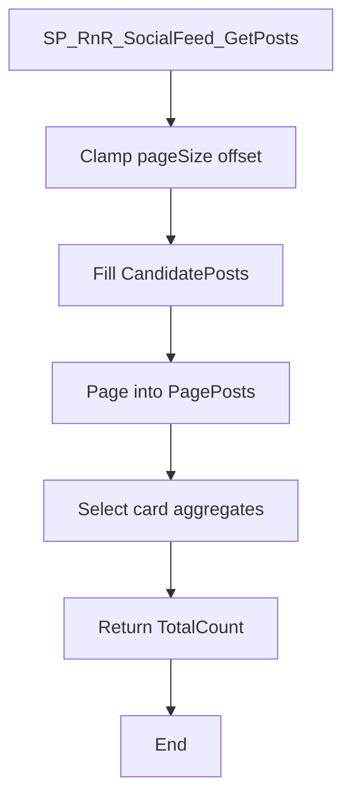

# SP_RnR_SocialFeed_GetPosts

## What it does

Pages employer social-feed posts into temp tables, then returns one result set of post cards (author name, hashtags, image URLs, reaction/comment counts, caller reaction, top reactions JSON) plus a second result set with TotalCount. Supports filters all / myDept / news / trending, optional author employee id, and search across body, title, author name, and hashtags.

## Parameters

| Name | Direction | What it is for |
|---|---|---|
| `@EmployerId` | in | Employer scope (required) |
| `@LoggedInEmployeeId` | in | Caller employee id for UserReactionType (optional) |
| `@EmployeeId` | in | Optional author filter |
| `@PageSize` | in | Page size (clamped 1-100, default 20) |
| `@Offset` | in | Row offset (default 0) |
| `@FilterType` | in | all | myDept | news | trending (default all) |
| `@BusinessUnitId` | in | Required for myDept filter (AuthorBusinessUnitId) |
| `@SearchQuery` | in | Optional free-text search |

## Call sequence

## Callers

No other procedure executes this object. App caller: RnR `GET /api/v1/social-feed` from [Social Feed](/docs/guides/reward-and-recognition/social-feed).

## Nested

- [FN_GetEmployeeName_Multi](/docs/database/hrms/FN_GetEmployeeName_Multi) — author name / search

## Steps

1. Clamp @PageSize and @Offset; build @SearchPattern when search is non-blank.
2. Insert candidate PostIds into #CandidatePosts with optional trending score (likes + active comments).
3. Filter by employer, IsActive, optional author, filterType, and search (including FN_GetEmployeeName_Multi and hashtags).
4. Page into #PagePosts ordered by trend score (when trending) then CreatedAt/PostId.
5. Select card columns joined to TEmployee with OUTER APPLY aggregates for hashtags, images, reactions, comments, user reaction, top reactions.
6. Return TotalCount from #CandidatePosts.

## Tables

| Table | Read or write |
|---|---|
| `dbo.TRnR_SocialPost` | read |
| `dbo.TRnR_SocialPostHashtag` | read |
| `dbo.TRnR_SocialPostImage` | read |
| `dbo.TRnR_SocialPostLike` | read |
| `dbo.TRnR_SocialPostComment` | read |
| `dbo.TEmployee` | read |

## Unresolved calls

None.

## Flow

