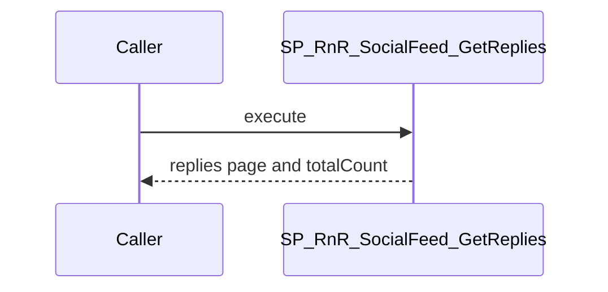
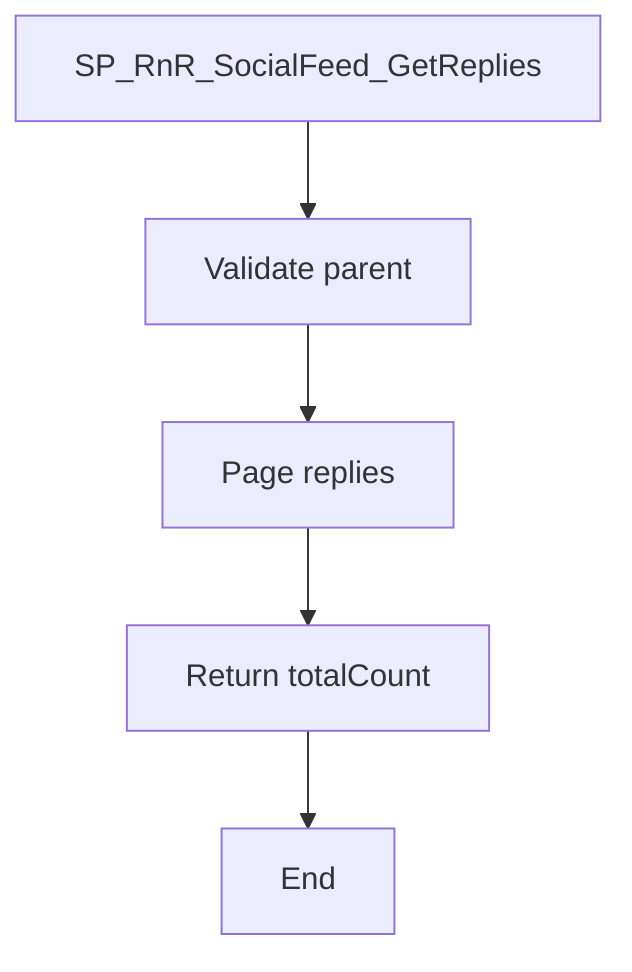

# SP_RnR_SocialFeed_GetReplies

## What it does

Returns cursor-paged direct replies to a parent comment (oldest first) with like/reply aggregates, plus totalCount. Raises if the parent comment is missing or inactive for the employer.

## Parameters

| Name | Direction | What it is for |
|---|---|---|
| `@EmployerId` | in | Employer scope |
| `@CommentId` | in | Parent comment id |
| `@EmployeeId` | in | Optional caller for userLiked |
| `@PageSize` | in | Page size (default 20) |
| `@LastReplyId` | in | Cursor - return CommentId greater than this |

## Call sequence

## Callers

No other procedure executes this object. App caller: RnR `GET /api/v1/social-feed/:postId/comments/:commentId/replies` from [Social Feed](/docs/guides/reward-and-recognition/social-feed).

## Nested

Calls no other procedures or functions.

## Steps

1. Guard active parent comment on active employer post.
2. Select direct active replies with aggregates and TEmployee name; apply cursor and page size.
3. Return totalCount of direct active replies.

## Tables

| Table | Read or write |
|---|---|
| `dbo.TRnR_SocialPost` | read |
| `dbo.TRnR_SocialPostComment` | read |
| `dbo.TRnR_SocialPostCommentLike` | read |
| `dbo.TEmployee` | read |

## Unresolved calls

None.

## Flow

