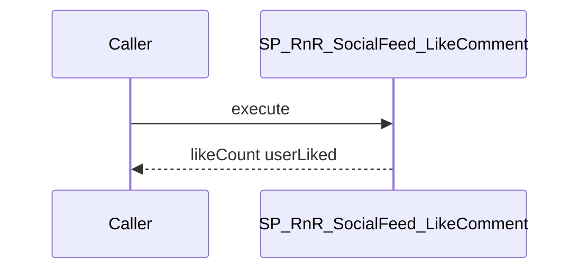
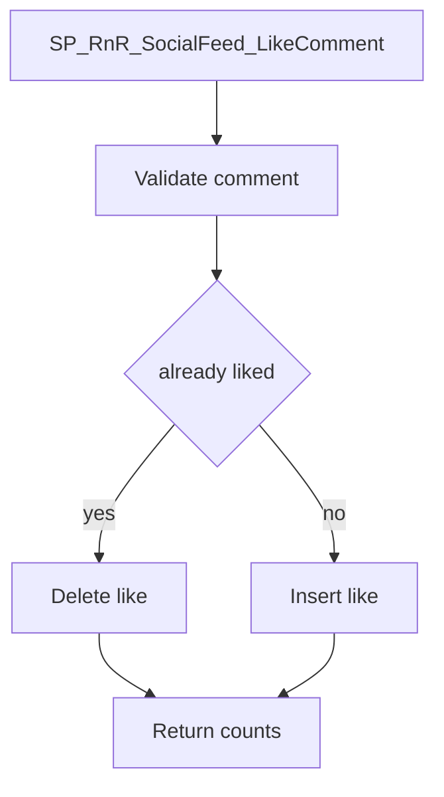

# SP_RnR_SocialFeed_LikeComment

## What it does

Toggles a like on an active comment whose post is active for the employer. Deletes the like row when one exists for the employee; otherwise inserts. Returns fresh likeCount and userLiked. Raises if the comment is missing or inactive.

## Parameters

| Name | Direction | What it is for |
|---|---|---|
| `@EmployerId` | in | Employer scope |
| `@CommentId` | in | Comment to like |
| `@EmployeeId` | in | Liking employee |

## Call sequence

## Callers

No other procedure executes this object. App caller: RnR `POST /api/v1/social-feed/:postId/comments/:commentId/like` from [Social Feed](/docs/guides/reward-and-recognition/social-feed).

## Nested

Calls no other procedures or functions.

## Steps

1. Guard active comment on active employer post.
2. If like exists for employee, DELETE; else INSERT.
3. Select likeCount and userLiked for the comment.

## Tables

| Table | Read or write |
|---|---|
| `dbo.TRnR_SocialPost` | read |
| `dbo.TRnR_SocialPostComment` | read |
| `dbo.TRnR_SocialPostCommentLike` | read/write |

## Unresolved calls

None.

## Flow

