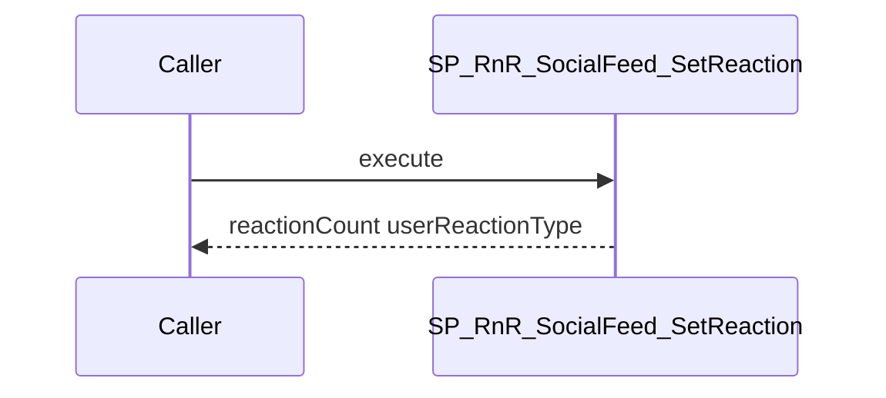
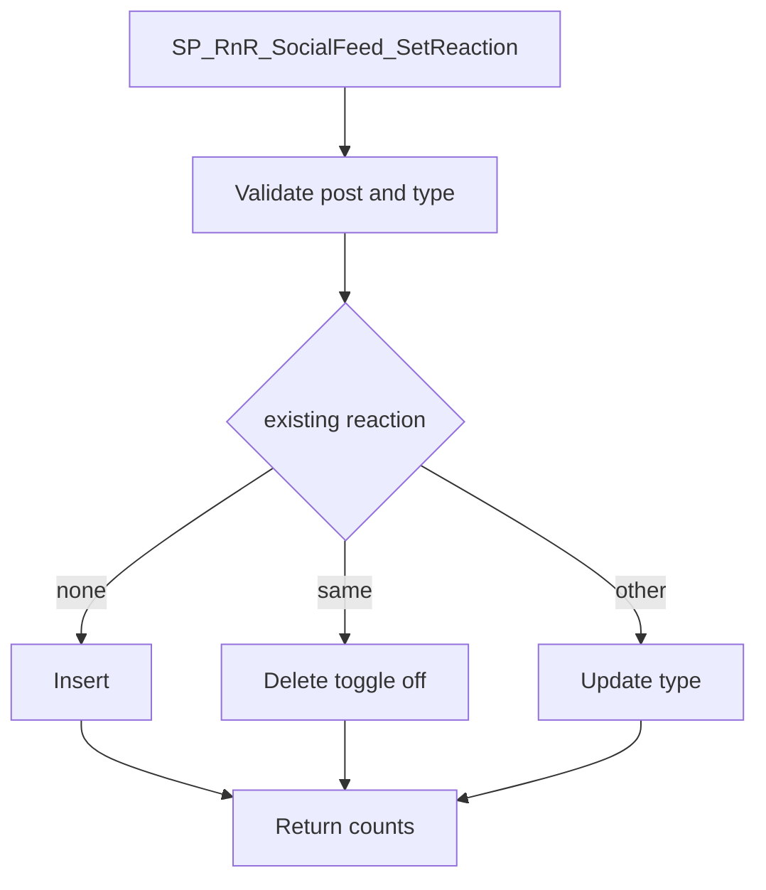

# SP_RnR_SocialFeed_SetReaction

## What it does

Sets the caller reaction on an active employer post. Inserts when none exists, deletes when the same type is sent again (toggle off), or updates when switching types. Runs under SERIALIZABLE transaction. Returns fresh reactionCount and userReactionType. Raises on missing/inactive post or invalid reaction type.

## Parameters

| Name | Direction | What it is for |
|---|---|---|
| `@EmployerId` | in | Employer scope |
| `@PostId` | in | Target post |
| `@EmployeeId` | in | Reactor employee id |
| `@ReactionType` | in | like | love | celebrate | support | insightful | funny |

## Call sequence

## Callers

No other procedure executes this object. App caller: RnR `POST /api/v1/social-feed/:postId/react` from [Social Feed](/docs/guides/reward-and-recognition/social-feed).

## Nested

Calls no other procedures or functions.

## Steps

1. Guard active post for employer; validate reaction type enum.
2. Read existing ReactionType for PostId/EmployeeId.
3. SERIALIZABLE transaction: insert, delete (same type), or update (different type).
4. Select reactionCount and caller userReactionType.

## Tables

| Table | Read or write |
|---|---|
| `dbo.TRnR_SocialPost` | read |
| `dbo.TRnR_SocialPostLike` | read/write |

## Unresolved calls

None.

## Flow

