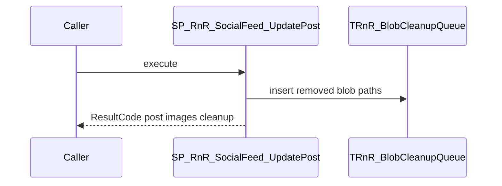
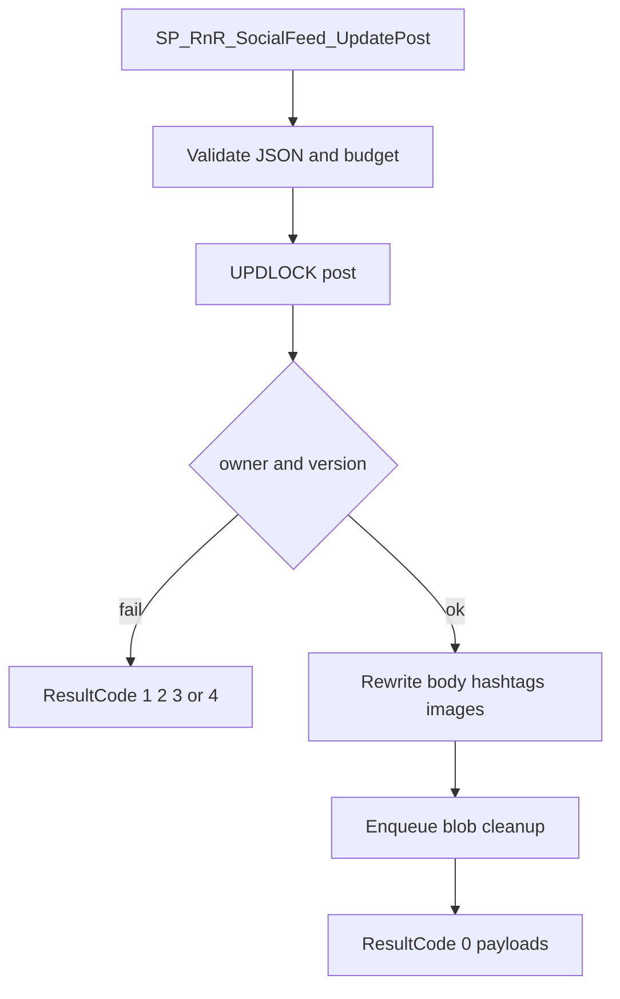

# SP_RnR_SocialFeed_UpdatePost

## What it does

Author-only optimistic update under a transaction. Validates JSON arrays and image budget (retained + new <= 5), locks the active post, checks ownership and RowVersion, rewrites body/hashtags/images, enqueues removed image URLs into TRnR_BlobCleanupQueue, then returns ResultCode plus updated post, images, and cleanup items. Result codes: 0 success, 1 not found, 2 forbidden, 3 version conflict, 4 invalid payload/selection.

## Parameters

| Name | Direction | What it is for |
|---|---|---|
| `@EmployerId` | in | Employer scope |
| `@PostId` | in | Post to update |
| `@EmployeeId` | in | Author employee id |
| `@Body` | in | New body text |
| `@HashtagsJson` | in | JSON array of hashtag strings |
| `@RetainedImageIdsJson` | in | JSON array of ImageIds to keep |
| `@NewImageUrlsJson` | in | JSON array of newly uploaded image URLs |
| `@ExpectedRowVersion` | in | BINARY(8) optimistic concurrency token |

## Call sequence

## Callers

No other procedure executes this object. App caller: RnR `PUT /api/v1/social-feed/:postId` from [Social Feed](/docs/guides/reward-and-recognition/social-feed).

## Nested

Calls no other procedures or functions. App-level blob cleanup uses `SP_RnR_BlobCleanup_*` after enqueue (not EXEC nesting).

## Steps

1. Validate JSON arrays are arrays; parse retained ids and new URLs; reject invalid counts or empty body+images.
2. BEGIN TRANSACTION with UPDLOCK on the post; ResultCode 1/2/3/4 on missing, non-author, stale RowVersion, or bad retained ImageId.
3. UPDATE Body/ModifiedAt/ModifiedByEmployeeId when RowVersion still matches.
4. Replace hashtags; delete non-retained images (capture URLs); reorder retained; insert new images.
5. INSERT removed URLs into TRnR_BlobCleanupQueue as Pending PostAttachmentRemoved.
6. COMMIT and return ResultCode 0, post row, images, cleanup items. CATCH rolls back and THROW.

## Tables

| Table | Read or write |
|---|---|
| `dbo.TRnR_SocialPost` | read/write |
| `dbo.TRnR_SocialPostHashtag` | write |
| `dbo.TRnR_SocialPostImage` | write |
| `dbo.TRnR_BlobCleanupQueue` | write |

## Unresolved calls

None.

## Flow

