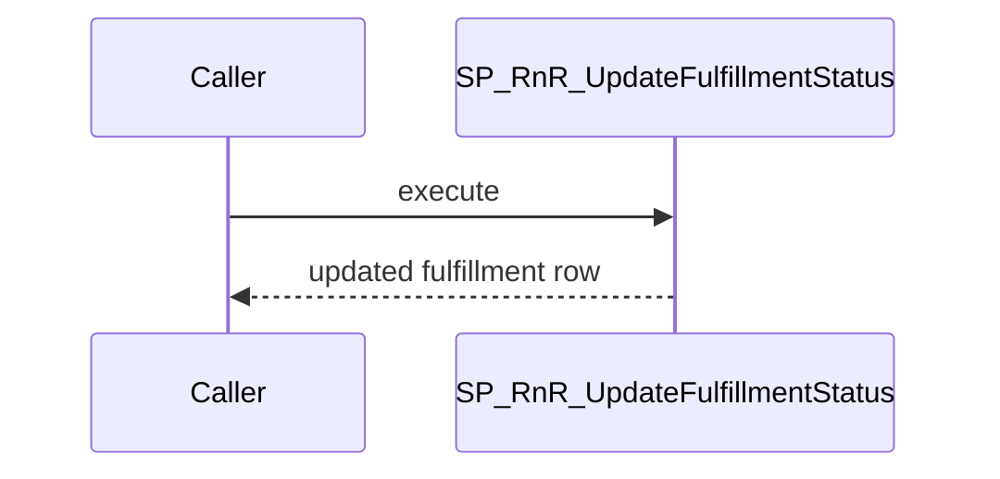
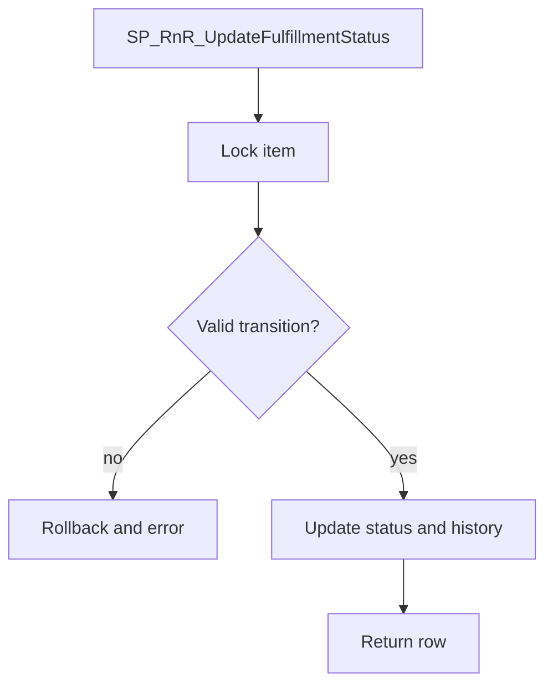

# SP_RnR_UpdateFulfillmentStatus

## What it does

Transitions a fulfillment item through `pending` / `in_progress` / `completed` / `cancelled` with assignment and note/reference updates. Rejects invalid transitions and terminal-state changes. Writes `TRnR_FulfillmentStatusHistory` and returns the updated item.

## Parameters

| Name | Direction | What it is for |
|---|---|---|
| `@FulfillmentItemId` | in | Item id |
| `@EmployerId` | in | Employer scope |
| `@ActorEmployeeId` | in | Acting user |
| `@NewStatus` | in | Target status |
| `@AssignTo` | in | Optional assignee |
| `@FulfillmentReference` / `@FulfillmentNote` | in | Optional reference/note |
| `@CancellationReason` | in | Required when cancelling |

## Call sequence

## Callers

No other procedure executes this object. App callers: Rewards_and_Recognition fulfillment admin status update → [Admin Console](/docs/guides/reward-and-recognition/admin-console).

## Nested

Calls no other procedures or functions.

## Steps

1. Script is `HRMS-DATABASE/HRMS-RewardNRecognition/STORED_PROCEDURE/SP_RnR_UpdateFulfillmentStatus.sql`.
2. Validate status vocabulary and cancellation reason.
3. Lock item; reject missing / terminal / invalid transition.
4. Update status and assignment/closure fields; insert history; return row.

## Tables

| Table | Read or write |
|---|---|
| `dbo.TRnR_FulfillmentItem` | read/write |
| `dbo.TRnR_FulfillmentStatusHistory` | write |

## Unresolved calls

None.

## Flow

