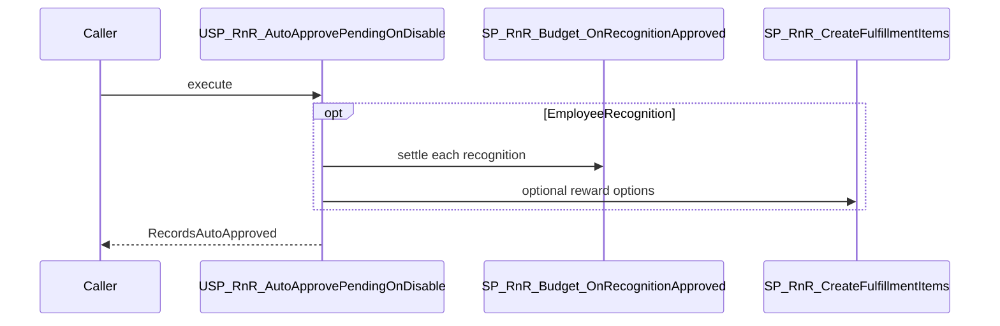
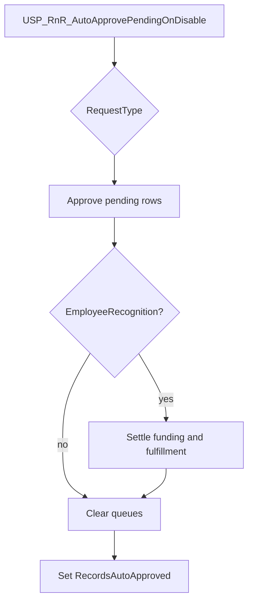

# USP_RnR_AutoApprovePendingOnDisable

## What it does

When a workflow toggle is switched off, auto-approves all pending rows for that `@RequestType` and employer, records status history where applicable, clears pending approver queues, and for `EmployeeRecognition` also settles budget (`SP_RnR_Budget_OnRecognitionApproved`) and may create fulfillment items. For finance, applies the newest pending request onto live `TFinanceConfiguration`. Sets `@RecordsAutoApproved` to the count affected.

## Parameters

| Name | Direction | What it is for |
|---|---|---|
| `@EmployerId` | in | Employer scope |
| `@RequestType` | in | Entity type being disabled |
| `@UserId` | in | Acting user |
| `@RecordsAutoApproved` | out | Count of auto-approved records |

## Call sequence

## Callers

Called by `USP_RnR_SaveWorkflowConfiguration`. App path is Workflow Configuration save on [Admin Console](/docs/guides/reward-and-recognition/admin-console).

## Nested

| Object | Kind | When |
|---|---|---|
| `SP_RnR_Budget_OnRecognitionApproved` | procedure | `EmployeeRecognition` per approved id |
| `SP_RnR_CreateFulfillmentItems` | procedure | recognition has reward option ids |

## Steps

1. Script is `HRMS-DATABASE/HRMS-RewardNRecognition/STORED_PROCEDURE/USP_RnR_AutoApprovePendingOnDisable.sql`.
2. Branch on `@RequestType` and approve pending rows into `@Affected`.
3. For EmployeeRecognition, per id settle funding and optional fulfillment; snapshot certificates when template present.
4. For RewardFinanceChange, approve Pending requests and apply latest to `TFinanceConfiguration`.
5. Clear related pending `TRequestWorkflows` / notification counts as implemented in the remainder of the script.
6. Set `@RecordsAutoApproved`.

## Tables

| Table | Read or write |
|---|---|
| `dbo.TEmployeeRecognition` / status history | write when EmployeeRecognition |
| `dbo.TRecognitionAwardTypesMaster` | write when RecognitionAward |
| `dbo.TJuryAwards` | write when JuryAward |
| `dbo.TEmployeeSpotlights` | write when SpotlightAward |
| `dbo.TWallOfFame` | write when WallOfFameAward |
| `dbo.TFinanceConfigurationRequest` / status history / `TFinanceConfiguration` | write when RewardFinanceChange |
| `dbo.TRequestWorkflows` | write/clear |

## Unresolved calls

None among nested (pages exist for funding / fulfillment).

## Flow

