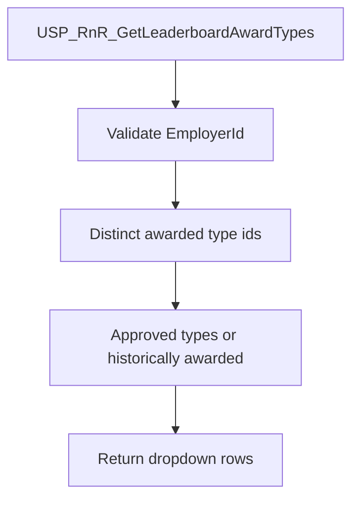

# USP_RnR_GetLeaderboardAwardTypes

## What it does

Returns recognition types for the Leaderboard type filter (PBI 162321). For one employer it includes every approved, non-deleted award type from `TRecognitionAwardTypesMaster`, plus any other type that already appears on an approved active `TEmployeeRecognition` row so historical points stay filterable. Rows sort approved live types first, then by display name.

## Parameters

| Name | Direction | What it is for |
|---|---|---|
| `@EmployerId` | in | Employer scope. Must be greater than 0 |

## Call sequence

Calls no other procedures or functions.

## Callers

No other procedure or function in `HRMS-RewardNRecognition/STORED_PROCEDURE` executes this object. App callers live in the Rewards_and_Recognition backend that is not in this SourceCode checkout.

| Object | Kind | Page |
|---|---|---|
| Leaderboard React / RnR API | app | [Leaderboard](/docs/guides/reward-and-recognition/leaderboard) (host only; API not in checkout) |

## Nested

Calls no other procedures or functions.

## Steps

In `HRMS-DATABASE/HRMS-RewardNRecognition/STORED_PROCEDURE/USP_RnR_GetLeaderboardAwardTypes.sql`:

1. Throw if `@EmployerId` is null or not greater than 0 (`Employer Not found.`).
2. CTE `awardedTypes` = distinct `award_type_id` from approved active recognitions for the employer.
3. Select master rows for the employer where status is approved and not deleted, or the type id appears in `awardedTypes`.
4. Return `id`, `displayName`, `status`, and `isDeleted`; order approved non-deleted first, then `display_name`.

## Tables

| Table | Read or write |
|---|---|
| `dbo.TEmployeeRecognition` | read |
| `dbo.TRecognitionAwardTypesMaster` | read |

## Flow

