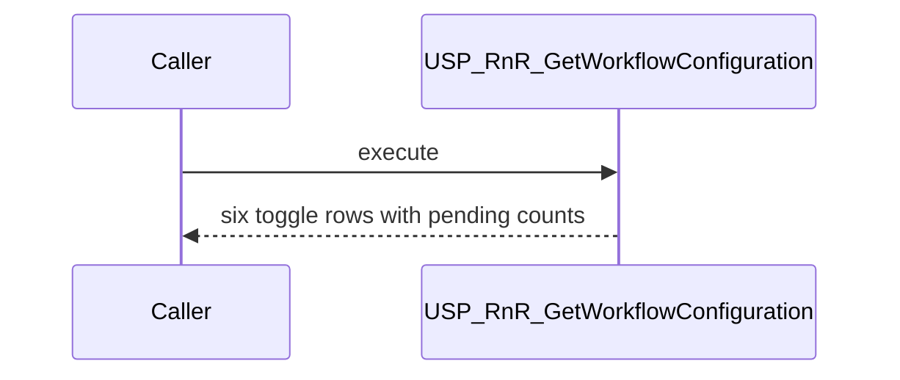
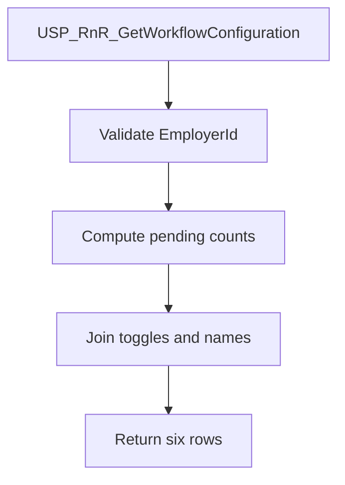

# USP_RnR_GetWorkflowConfiguration

## What it does

Returns the six Admin Console workflow toggles (RecognitionAward, JuryAward, SpotlightAward, WallOfFameAward, RewardFinanceChange, EmployeeRecognition) with pending counts, last-changed user display name, and timestamps. Defaults missing rows to enabled. Pending predicates match `USP_RnR_AutoApprovePendingOnDisable`.

## Parameters

| Name | Direction | What it is for |
|---|---|---|
| `@EmployerId` | in | Employer scope (must be > 0) |

## Call sequence

## Callers

No other procedure executes this object. App callers: Rewards_and_Recognition `GET /api/v1/rewards/admin/workflow-configuration` → [Admin Console](/docs/guides/reward-and-recognition/admin-console).

## Nested

| Object | Kind | When |
|---|---|---|
| `FN_GetEmployeeName_Multi` | function | when last-changed user is present and non-zero |

## Steps

1. Script is `HRMS-DATABASE/HRMS-RewardNRecognition/STORED_PROCEDURE/USP_RnR_GetWorkflowConfiguration.sql`.
2. Reject invalid `@EmployerId`.
3. Aggregate pending counts per request type from award / recognition / finance request tables.
4. Left-join `TRnR_WorkflowConfiguration` to the fixed six-row entity list and resolve display names.

## Tables

| Table | Read or write |
|---|---|
| `dbo.TRnR_WorkflowConfiguration` | read |
| `dbo.TRecognitionAwardTypesMaster` | read |
| `dbo.TJuryAwards` | read |
| `dbo.TEmployeeSpotlights` | read |
| `dbo.TWallOfFame` | read |
| `dbo.TEmployeeRecognition` | read |
| `dbo.TFinanceConfigurationRequest` | read |
| `dbo.TEmployeeInfo` | read |

## Unresolved calls

None.

## Flow

