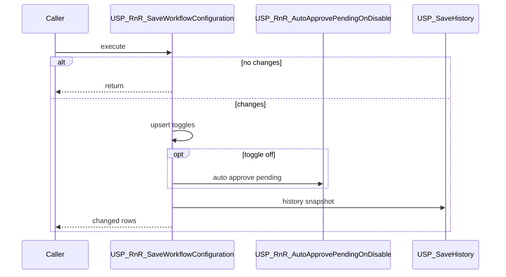
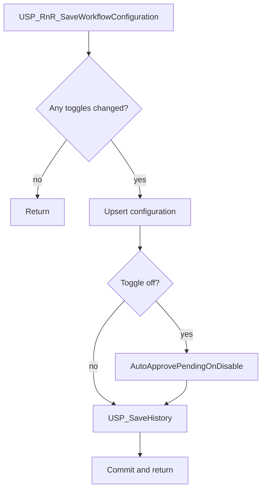

# USP_RnR_SaveWorkflowConfiguration

## What it does

Saves only the workflow toggles whose value changed (TVP `RnRWorkflowConfigurationTableType`) in one transaction. Upserts `TRnR_WorkflowConfiguration`. When a toggle is switched off, runs `USP_RnR_AutoApprovePendingOnDisable` and stores `RecordsAutoApproved`, then snapshots each changed row with `USP_SaveHistory`. Returns the changed request types and before/after flags.

## Parameters

| Name | Direction | What it is for |
|---|---|---|
| `@EmployerId` | in | Employer scope |
| `@Toggles` | in | TVP of RequestType + IsWorkflowEnabled |
| `@UserId` | in | Acting user |

## Call sequence

## Callers

No other procedure executes this object. App callers: Rewards_and_Recognition workflow-configuration save → [Admin Console](/docs/guides/reward-and-recognition/admin-console).

## Nested

| Object | Kind | When |
|---|---|---|
| `USP_RnR_AutoApprovePendingOnDisable` | procedure | when a changed toggle’s new value is off |
| `USP_SaveHistory` | procedure (synonym) | per changed config row |

## Steps

1. Script is `HRMS-DATABASE/HRMS-RewardNRecognition/STORED_PROCEDURE/USP_RnR_SaveWorkflowConfiguration.sql`.
2. Diff TVP against current toggles; return early if none changed.
3. Update existing / insert missing `TRnR_WorkflowConfiguration` rows.
4. For each change with ToEnabled = 0, sweep pending and store count.
5. Snapshot each changed row via `USP_SaveHistory` using `DB_NAME()`.
6. Commit and select change summary.

## Tables

| Table | Read or write |
|---|---|
| `dbo.TRnR_WorkflowConfiguration` | read/write |
| `dbo.TRnR_WorkflowConfiguration_History` | write via USP_SaveHistory |

## Unresolved calls

`USP_SaveHistory` synonym target body not in RewardNRecognition Liquibase tree.

## Flow

