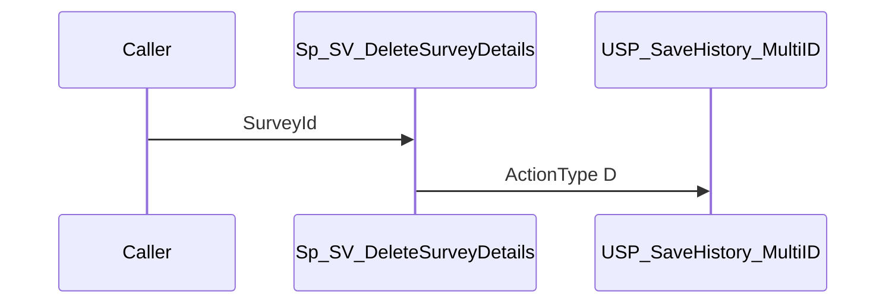
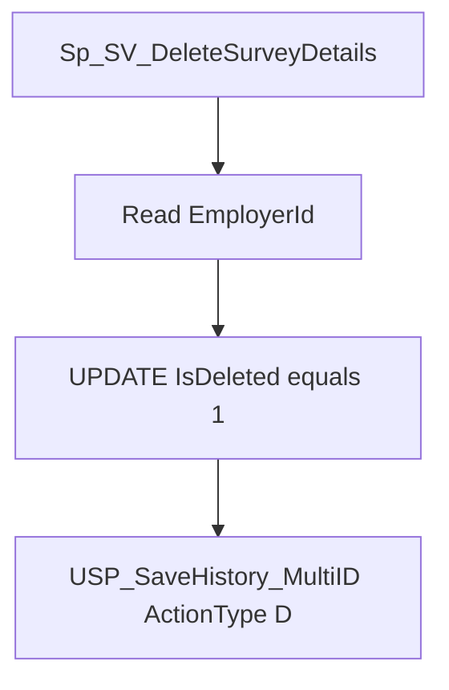

# Sp_SV_DeleteSurveyDetails

## What it does

Soft-deletes a survey by setting `IsDeleted = 1` and copies the row into `TSurvey_History` via the shared multi-id history procedure (history actor is the survey's `EmployerId`).

## Parameters

| Name | Direction | What it is for |
|---|---|---|
| `@pSurveyId` | in | Survey to soft-delete |

## Call sequence

## Callers

No other procedure or function calls this object. Application caller: Survey API `surveyDAL.DeleteSurveyDetails` from Survey List Delete.

| Object | Kind | Page |
|---|---|---|
| — | — | No SQL callers |

## Nested

| Object | Kind | When | Page |
|---|---|---|---|
| `USP_SaveHistory_MultiID` | procedure | after soft delete | [USP_SaveHistory_MultiID](/docs/database/hrms/USP_SaveHistory_MultiID) |

## Steps

1. Script is `HRMS-DATABASE/HRMS-SURVEY/STOREPROCEDURE/Sp_SV_DeleteSurveyDetails.sql`.
2. Read `@employerId` from `TSurvey` for the survey.
3. Set action type to `D`.
4. `UPDATE TSurvey` set `IsDeleted = 1` for `@pSurveyId`.
5. Exec `USP_SaveHistory_MultiID` with `@HistoryCreatedBy = @employerId`.

## Tables

| Table | Read or write |
|---|---|
| `dbo.TSurvey` | read, write |
| `dbo.TSurvey_History` | write (via history proc) |

## Flow

