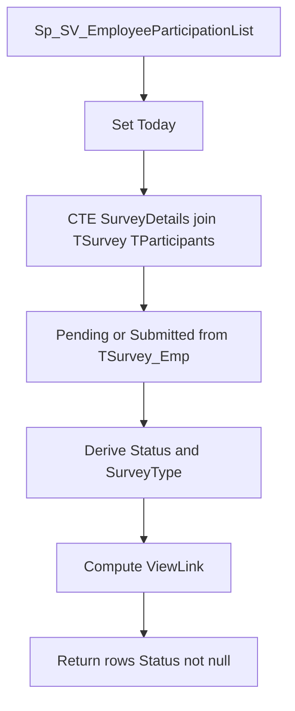

# Sp_SV_EmployeeParticipationList

## What it does

Returns published, non-deleted surveys where `@pEmployeeId` is a row in `TParticipants`. Each row includes custom survey id, title, start/end dates, Pending vs Submitted (from `TSurvey_Emp`), derived status (In Progress / Closed / Force Closed), Confidential vs Anonymous type, and a `ViewLink` action label (Start Survey, View, or blank).

## Parameters

| Name | Direction | What it is for |
|---|---|---|
| `@pEmployeeId` | in | Participant whose surveys are listed |
| `@pEmployerId` | in | Accepted by the signature; employer filter is commented out in the live script |

## Call sequence

Calls no other procedures or functions.

## Callers

No other procedure or function calls this object. App caller: `surveyDAL.GetEmployeeParticipationList` (My Participation grid).

## Nested

Calls no other procedures or functions.

## Steps

In `HRMS-DATABASE/HRMS-SURVEY/STOREPROCEDURE/Sp_SV_EmployeeParticipationList.sql`:

1. Set `@Today` to today's date.
2. CTE `SurveyDetails` joins `TSurvey` to `TParticipants` for `@pEmployeeId`, requiring `IsPublished = 1` and `IsDeleted = 0`.
3. Set `SurveySubmitted` / `SurveySubmittedFlag` from existence of `TSurvey_Emp` for that employee and survey.
4. Derive `Status` from `IsPublished`, `IsClosed`, and start/end vs `@Today`.
5. Map `IsConfidential` to SurveyType Confidential or Anonymous.
6. Outer select adds `ViewLink` from Status + SurveySubmitted, drops rows with null Status, orders by `SurveyID` descending.

## Tables

| Table | Read or write |
|---|---|
| `dbo.TSurvey` | read |
| `dbo.TParticipants` | read |
| `dbo.TSurvey_Emp` | read (EXISTS) |

## Flow

