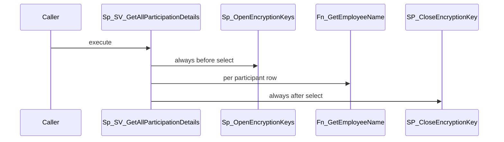
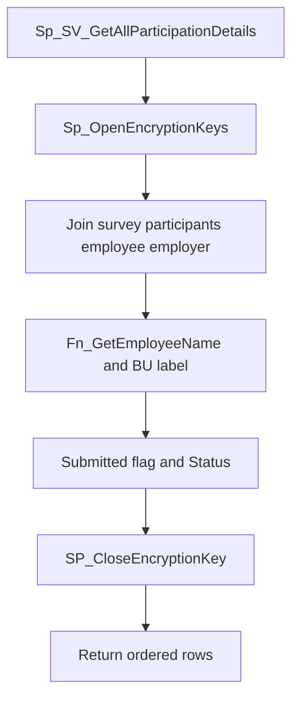

# Sp_SV_GetAllParticipationDetails

## What it does

Lists every participant for one survey across a comma-separated employer list. Each row includes employment number, display name (`Fn_GetEmployeeName`), business unit label from org hierarchy, submitted Yes/No, survey type, employer name, submitted datetime, and derived survey status. Opens and closes encryption keys around the select (Survey synonyms to HRMS).

## Parameters

| Name | Direction | What it is for |
|---|---|---|
| `@pEmployerId` | in | Comma-separated employer ids for `TParticipants.EmployerId` |
| `@pSurveyId` | in | Survey whose participants are listed |

## Call sequence

## Callers

No other procedure or function calls this object. App caller: `surveyDAL.GetAllParticipationDetails` (All Participation grid).

## Nested

| Object | Kind | When | Page |
|---|---|---|---|
| `Sp_OpenEncryptionKeys` | procedure | always, before the select | [Sp_OpenEncryptionKeys](/docs/database/hrms/Sp_OpenEncryptionKeys) (HRMS; Survey synonym) |
| `Fn_GetEmployeeName` | function | each participant row | [Fn_GetEmployeeName](/docs/database/hrms/Fn_GetEmployeeName) (HRMS; Survey synonym) |
| `SP_CloseEncryptionKey` | procedure | always, after the select | [SP_CloseEncryptionKey](/docs/database/hrms/SP_CloseEncryptionKey) (HRMS; Survey synonym) |

## Steps

In `HRMS-DATABASE/HRMS-SURVEY/STOREPROCEDURE/Sp_SV_GetAllParticipationDetails.sql`:

1. Set `@Today` to today's date.
2. `Exec dbo.Sp_OpenEncryptionKeys`.
3. Select from `TSurvey` joined to `TParticipants`, `Temployerdetails`, and `TEmployeeInfo`, with outer apply latest `TSurvey_Emp` for submitted flag/datetime.
4. Compute business unit name via `TOrgHierarchyDetails` parent unit; employee display name via `dbo.Fn_GetEmployeeName`.
5. Filter participants whose employer is in the split list, matching `@pSurveyId`, and survey closed or start date ≤ `@Today`.
6. Order submitted surveys first, then by `CreatedOn` descending.
7. `Exec dbo.SP_CloseEncryptionKey`.

## Tables

| Table | Read or write |
|---|---|
| `dbo.TSurvey` | read |
| `dbo.TParticipants` | read |
| `dbo.Temployerdetails` | read (synonym) |
| `dbo.TEmployeeInfo` | read (synonym) |
| `dbo.TSurvey_Emp` | read |
| `dbo.TOrgHierarchyDetails` | read (synonym) |

## Flow

