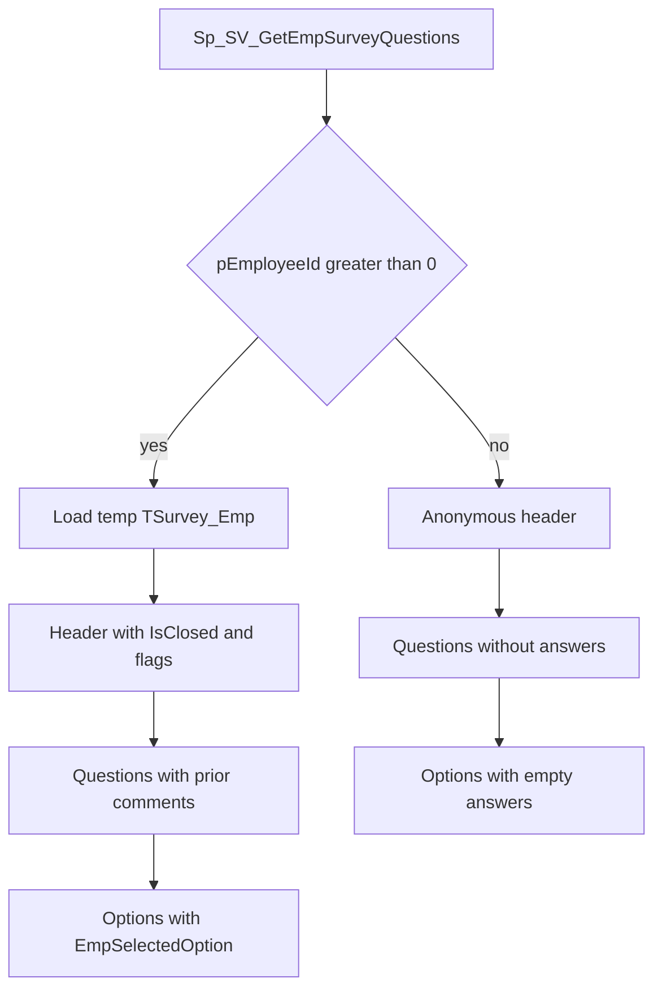

# Sp_SV_GetEmpSurveyQuestions

## What it does

Loads one survey’s header and questionnaire. When `@pEmployeeId > 0` (confidential path), it also returns prior answers from `TSurvey_Emp`, participant/submitted/completed flags, and `IsClosed`. When `@pEmployeeId` is 0/absent (anonymous path), it returns a thinner header (including thank-you message) and unanswered option rows. My Participation’s closed-check uses the confidential path and only needs the first result set.

## Parameters

| Name | Direction | What it is for |
|---|---|---|
| `@pSurveyId` | in | Survey to load |
| `@pEmployeeId` | in | Employee for confidential answers and flags; default `0` selects the anonymous branch |

## Call sequence

Calls no other procedures or functions.

## Callers

No other procedure or function calls this object. App callers: `surveyDAL.CheckEmpSurveyQuestions` and `surveyDAL.GetEmpSurveyQuestions`.

## Nested

Calls no other procedures or functions.

## Steps

In `HRMS-DATABASE/HRMS-SURVEY/STOREPROCEDURE/Sp_SV_GetEmpSurveyQuestions.sql`:

1. Branch on `@pEmployeeId > 0`.
2. Confidential branch: materialize `#tempTSurvey_Emp` for the survey and employee.
3. Result set 1 — header from `TSurvey` (title, confidential flag, IsSubmitted, IsParticipant, IsCompleted, comments flags, `IsClosed`, etc.).
4. Result set 2 — distinct questions via `TQuestion` / `TSurveyQuestions`, left join temp answers, ordered by `SequenceNo`.
5. Result set 3 — options from `TQuestionOption` with employee selected option / answer text / reason / remarks.
6. Else (anonymous): header without participant flags; questions without answers; options with zero selected flags.

## Tables

| Table | Read or write |
|---|---|
| `dbo.TSurvey` | read |
| `dbo.TSurvey_Emp` | read |
| `dbo.TParticipants` | read (EXISTS) |
| `dbo.TSurveyQuestions` | read |
| `dbo.TQuestion` | read |
| `dbo.TQuestionOption` | read |

## Flow

