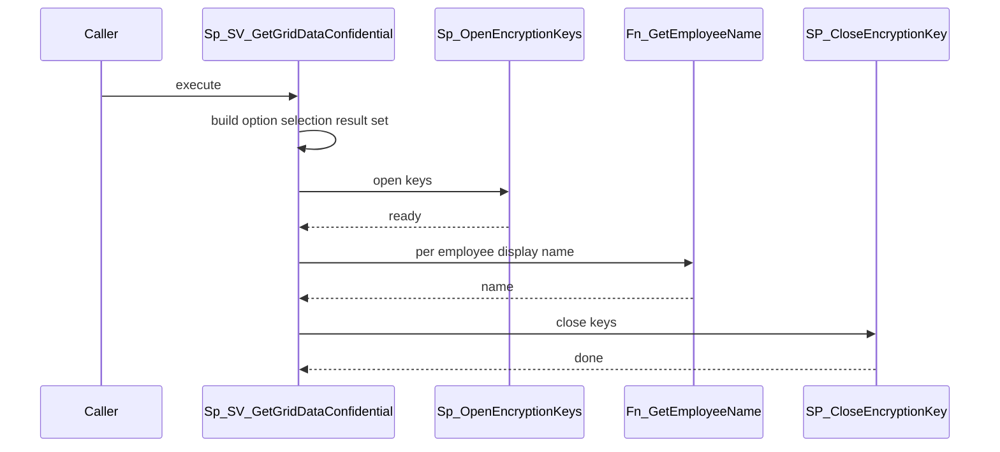
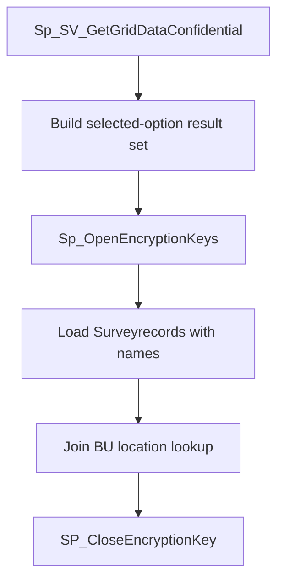

# Sp_SV_GetGridDataConfidential

## What it does

Returns flattened respondent answer rows for one survey (title, employer, employment number, employee name, question, answer, answer type name, comments, business unit, location, submitted datetime, sequence, reason). Opens encryption keys so employee name decryption can run, then closes them. Despite the name, Survey Analytics also calls this endpoint for Anonymous survey grids.

## Parameters

| Name | Direction | What it is for |
|---|---|---|
| `@pSurveyId` | in | Survey whose selected answers are listed |

## Call sequence

## Callers

No other procedure or function calls this object. App caller: `surveyDAL.GetGridDataConfidential`.

## Nested

| Object | Kind | When | Page |
|---|---|---|---|
| `Sp_OpenEncryptionKeys` | procedure | before employee-name select | [Sp_OpenEncryptionKeys](/docs/database/hrms/Sp_OpenEncryptionKeys) |
| `Fn_GetEmployeeName` | function | per employee row | [Fn_GetEmployeeName](/docs/database/hrms/Fn_GetEmployeeName) |
| `SP_CloseEncryptionKey` | procedure | after final select | [SP_CloseEncryptionKey](/docs/database/hrms/SP_CloseEncryptionKey) |

## Steps

In `HRMS-DATABASE/HRMS-SURVEY/STOREPROCEDURE/Sp_SV_GetGridDataConfidential.sql`:

1. Drop `#Surveyrecords` if it exists.
2. Insert into `@ResultSet` joining questions, options, survey questions, and `TSurvey_Emp`, marking EmpSelectedOption when the employee selected that option; include Comments and Reason.
3. Execute `Sp_OpenEncryptionKeys`.
4. Insert into `#Surveyrecords` from `TSurvey` and selected `@ResultSet` rows (EmpSelectedOption = 1), with EmploymentNumber from `TEmployeeInfo`, `Fn_GetEmployeeName`, answer text (descriptive uses QuesOptionText), and SubmittedDateTime from latest `TSurvey_Emp.CreatedOn`.
5. Select final grid from `#Surveyrecords` joined to `TEmployerDetails`, `TEmployeeInfo`, optional `TOrgHierarchyDetails` and `TLocation`, resolving AnswerTypeName from `TQuestion_LOOKUP`.
6. Execute `SP_CloseEncryptionKey`.

## Tables

| Table | Read or write |
|---|---|
| `dbo.TQuestion` | read |
| `dbo.TQuestionOption` | read |
| `dbo.TSurveyQuestions` | read |
| `dbo.TSurvey_Emp` | read |
| `dbo.TSurvey` | read |
| `dbo.TEmployeeInfo` | read |
| `dbo.TEmployerDetails` | read |
| `dbo.TQuestion_LOOKUP` | read |
| `dbo.TOrgHierarchyDetails` | read |
| `dbo.TLocation` | read |

## Flow

