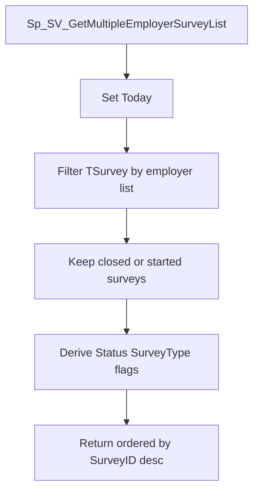

# Sp_SV_GetMultipleEmployerSurveyList

## What it does

Returns non-deleted surveys whose `EmployerId` is in a comma-separated list. Each row includes title, category, dates, derived year, published/submitted status text, Confidential vs Anonymous type, and created/edited dates. Rows are limited to closed surveys or those whose start date is on or before today. Used by All Participation to build year and survey filter lists.

## Parameters

| Name | Direction | What it is for |
|---|---|---|
| `@pEmployerId` | in | Comma-separated employer ids; matched via `String_Split` |

## Call sequence

Calls no other procedures or functions.

## Callers

No other procedure or function calls this object. App caller: `surveyDAL.GetMultipleEmployerSurveyList` (All Participation filters).

## Nested

Calls no other procedures or functions.

## Steps

In `HRMS-DATABASE/HRMS-SURVEY/STOREPROCEDURE/Sp_SV_GetMultipleEmployerSurveyList.sql`:

1. Set `@Today` to today's date.
2. Select from `TSurvey` where `EmployerId` is in the split `@pEmployerId` list and `IsDeleted = 0`.
3. Keep rows where `IsClosed = 1` or start date ≤ `@Today`.
4. Derive `IsSubmitted` / `IsPublished` display strings, `Status` from published/submitted/date window, and `SurveyType` from `IsConfidential`.
5. Order by `SurveyID` descending.

## Tables

| Table | Read or write |
|---|---|
| `dbo.TSurvey` | read |

## Flow

