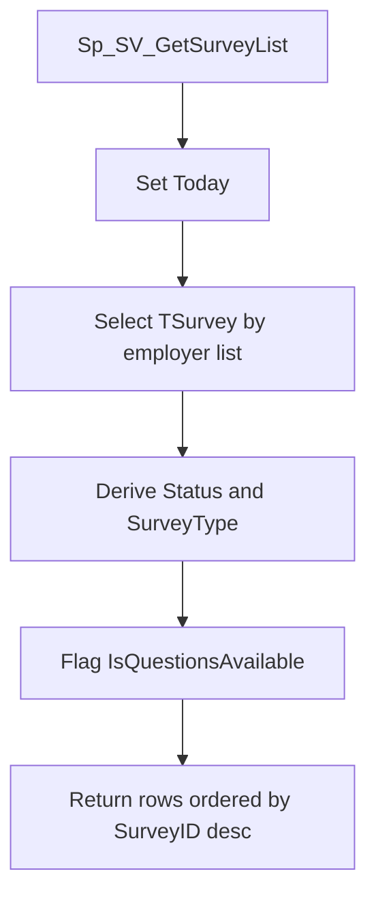

# Sp_SV_GetSurveyList

## What it does

Returns non-deleted surveys for one or more employer ids (comma-separated). Each row includes title, category, start/end dates, derived year, published/submitted/closed status text, confidential vs anonymous type, employer name, and whether the survey has any questions.

## Parameters

| Name | Direction | What it is for |
|---|---|---|
| `@pEmployerId` | in | Comma-separated employer ids; rows must match `STRING_SPLIT` values |

## Call sequence

Calls no other procedures or functions.

## Callers

No other procedure or function calls this object. App caller: `surveyDAL.GetSurveyList` (Survey Analytics and Survey Setup list UIs).

## Nested

Calls no other procedures or functions.

## Steps

In `HRMS-DATABASE/HRMS-SURVEY/STOREPROCEDURE/Sp_SV_GetSurveyList.sql`:

1. Set `@Today` to today's date.
2. Select from `TSurvey` joined to `Temployerdetails` where `EmployerId` is in the split `@pEmployerId` list and `IsDeleted = 0`.
3. Derive `Status` from `IsSubmitted` / `IsPublished` / `IsClosed` and start/end vs `@Today` (In Progress, Completed, Published, Submitted, Not Published, Saved as Draft, Force Closed).
4. Map `IsConfidential` to SurveyType Confidential or Anonymous.
5. Set `IsQuestionsAvailable` when any `TSurveyQuestions` row exists for the survey.
6. Order by `SurveyID` descending.

## Tables

| Table | Read or write |
|---|---|
| `dbo.TSurvey` | read |
| `dbo.Temployerdetails` | read |
| `dbo.TSurveyQuestions` | read (EXISTS) |

## Flow

