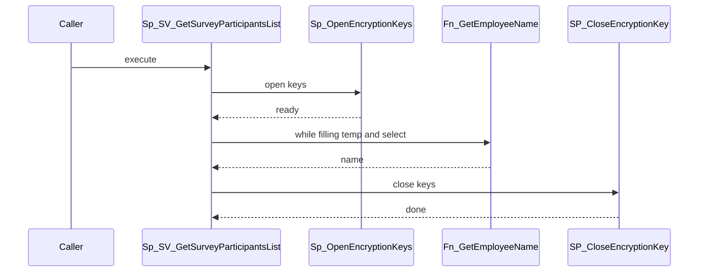
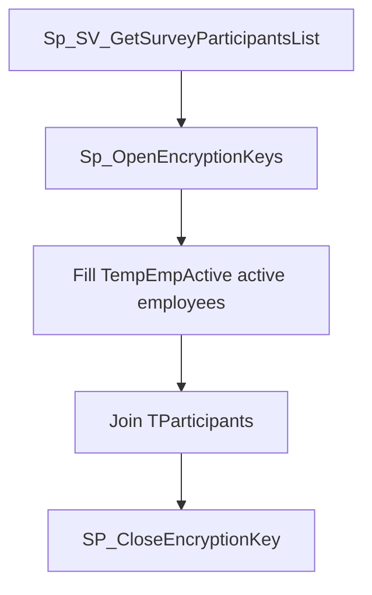

# Sp_SV_GetSurveyParticipantsList

## What it does

Returns assigned participants for one or more survey ids (comma-separated). Builds a global temp of active employees under the survey's root employer, opens encryption keys for name decryption, then returns participant employment number, name, business unit, and employer.

## Parameters

| Name | Direction | What it is for |
|---|---|---|
| `@pSurveyId` | in | Comma-separated survey ids |

## Call sequence

## Callers

No other procedure or function calls this object. App caller: `surveyDAL.GetParticipantList`. Sibling script `USP_SV_GetSurveyParticipantsList` exists but is not what Analytics DAL executes.

## Nested

| Object | Kind | When | Page |
|---|---|---|---|
| `Sp_OpenEncryptionKeys` | procedure | start of body | [Sp_OpenEncryptionKeys](/docs/database/hrms/Sp_OpenEncryptionKeys) |
| `Fn_GetEmployeeName` | function | temp fill and select | [Fn_GetEmployeeName](/docs/database/hrms/Fn_GetEmployeeName) |
| `SP_CloseEncryptionKey` | procedure | end of body | [SP_CloseEncryptionKey](/docs/database/hrms/SP_CloseEncryptionKey) |

## Steps

In `HRMS-DATABASE/HRMS-SURVEY/STOREPROCEDURE/Sp_SV_GetSurveyParticipantsList.sql`:

1. Execute `Sp_OpenEncryptionKeys`.
2. Drop and recreate global temp `##TempEmpActive`.
3. Insert active employees (`TEmployee.IsActive = 'Y'`) whose employer's `RootEmployerId` matches the root of any survey in `@pSurveyId`, with decrypted `Fn_GetEmployeeName`.
4. Select from `TParticipants` joined to `##TempEmpActive` for those survey ids, including business unit name from `TOrgHierarchyDetails`.
5. Execute `SP_CloseEncryptionKey`.

## Tables

| Table | Read or write |
|---|---|
| `dbo.TEmployeeInfo` | read |
| `dbo.TEmployee` | read |
| `dbo.TORGChart` | read |
| `dbo.TemployerDetails` | read |
| `dbo.TSurvey` | read |
| `dbo.TParticipants` | read |
| `dbo.TOrgHierarchyDetails` | read |

## Flow

