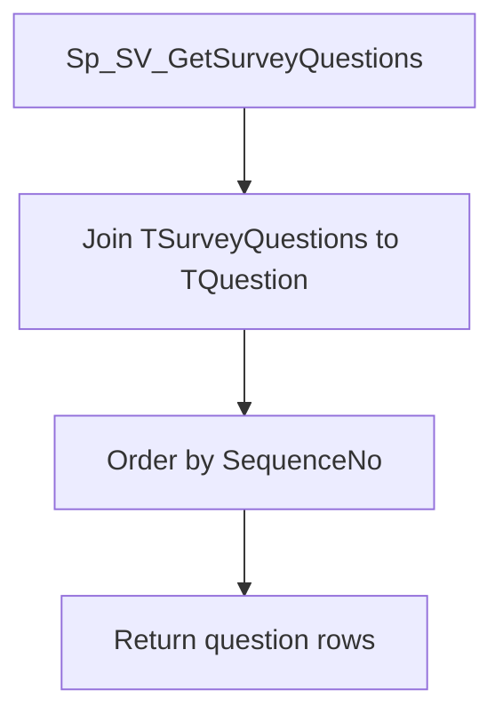

# Sp_SV_GetSurveyQuestions

## What it does

Returns the ordered question list for one survey: survey-question id, question text, question id, and sequence number. Used by Survey Analytics to populate the question multi-select filter.

## Parameters

| Name | Direction | What it is for |
|---|---|---|
| `@pSurveyId` | in | Survey whose questions are listed |

## Call sequence

Calls no other procedures or functions.

## Callers

No other procedure or function calls this object. App caller: `surveyDAL.GetSurveyQuestions`.

## Nested

Calls no other procedures or functions.

## Steps

In `HRMS-DATABASE/HRMS-SURVEY/STOREPROCEDURE/Sp_SV_GetSurveyQuestions.sql`:

1. Select `SurveyQuestionID`, `QuestionText`, `QuestionID`, `SequenceNo` from `TSurveyQuestions` joined to `TQuestion` for `@pSurveyId`.
2. Order by `SequenceNo`.

## Tables

| Table | Read or write |
|---|---|
| `dbo.TSurveyQuestions` | read |
| `dbo.TQuestion` | read |

## Flow

