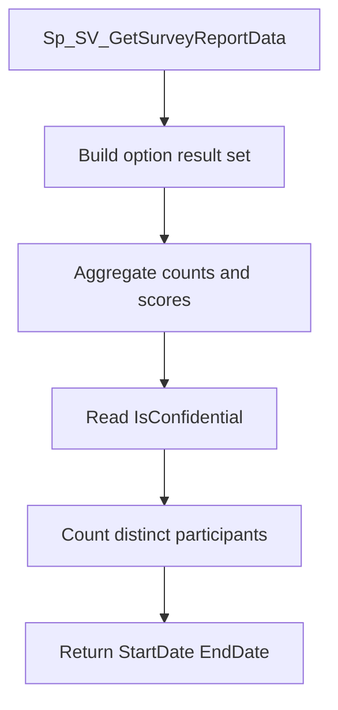

# Sp_SV_GetSurveyReportData

## What it does

Builds option-level answer counts and weightage scores for one survey's chart report. Returns three result sets: aggregated option counts (with SumQuestionScore / Maxweightage), total unique participants (by EmployeeId when confidential, by IPAddress when anonymous), and the survey start/end dates.

## Parameters

| Name | Direction | What it is for |
|---|---|---|
| `@pSurveyId` | in | Survey to aggregate |

## Call sequence

Calls no other procedures or functions.

## Callers

No other procedure or function calls this object. App caller: `surveyDAL.GetSurveyReportData` (groups result set 0 in Node before returning to Analytics).

## Nested

Calls no other procedures or functions.

## Steps

In `HRMS-DATABASE/HRMS-SURVEY/STOREPROCEDURE/Sp_SV_GetSurveyReportData.sql`:

1. Insert into `@ResultSet` by joining `TQuestion`, `TQuestionOption`, `TSurveyQuestions`, and left-joining `TSurvey_Emp` for matching option selections; compute per-row Count and weightage from option sequence.
2. Select grouped option aggregates (Count, SumQuestionScore, Maxweightage) ordered by SequenceNo.
3. Read `IsConfidential` from `TSurvey`.
4. Set `@TotalParticipants` to distinct `EmployeeId` when confidential, else distinct `IPAddress`, from `TSurvey_Emp`.
5. Return `@TotalParticipants` as TotalParticipants.
6. Return `StartDate` and `EndDate` from `TSurvey`.

## Tables

| Table | Read or write |
|---|---|
| `dbo.TQuestion` | read |
| `dbo.TQuestionOption` | read |
| `dbo.TSurveyQuestions` | read |
| `dbo.TSurvey_Emp` | read |
| `dbo.TSurvey` | read |

## Flow

