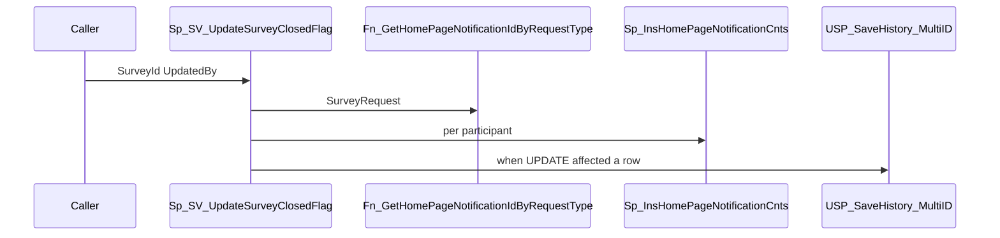
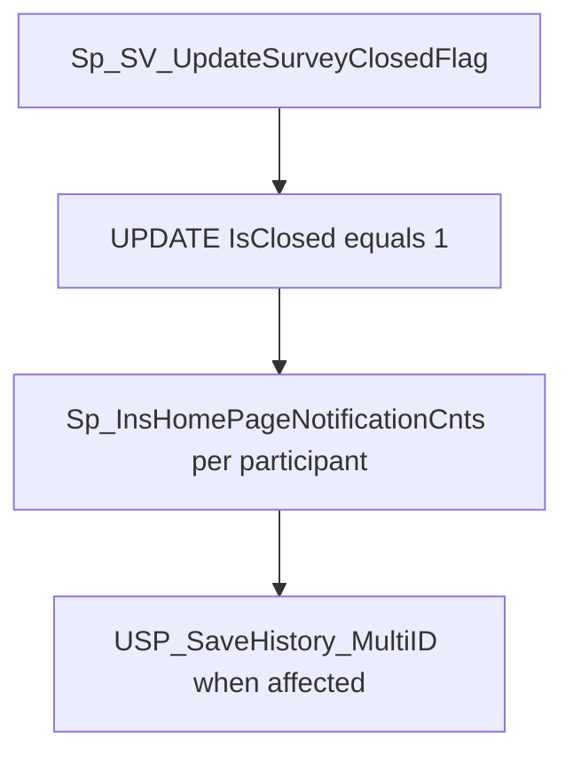

# Sp_SV_UpdateSurveyClosedFlag

## What it does

Force-closes a survey by setting `IsClosed = 1`, bumps home-page notification counts for each participant, and writes survey history. Email queue inserts in this script are commented out.

## Parameters

| Name | Direction | What it is for |
|---|---|---|
| `@pSurveyId` | in | Survey to close |
| `@pUpdatedBy` | in | Employee id stored on `EditedBy` and history |

## Call sequence

## Callers

No other procedure or function calls this object. Application caller: Survey API `surveyDAL.CloseSurveyDetails` from Survey List Force Close.

| Object | Kind | Page |
|---|---|---|
| — | — | No SQL callers |

## Nested

| Object | Kind | When | Page |
|---|---|---|---|
| `Fn_GetHomePageNotificationIdByRequestType` | function | always (notification id) | [Fn_GetHomePageNotificationIdByRequestType](/docs/database/hrms/Fn_GetHomePageNotificationIdByRequestType) |
| `Sp_InsHomePageNotificationCnts` | procedure | once per participant | [Sp_InsHomePageNotificationCnts](/docs/database/hrms/Sp_InsHomePageNotificationCnts) |
| `USP_SaveHistory_MultiID` | procedure | when the survey row was updated | [USP_SaveHistory_MultiID](/docs/database/hrms/USP_SaveHistory_MultiID) |

## Steps

1. Script is `HRMS-DATABASE/HRMS-SURVEY/STOREPROCEDURE/Sp_SV_UpdateSurveyClosedFlag.sql`.
2. Read `IsConfidential` and `StartDate` from `TSurvey` (start date unused while email block is commented).
3. Resolve home-page notification id via `Fn_GetHomePageNotificationIdByRequestType('SurveyRequest')`.
4. `UPDATE TSurvey` set `IsClosed = 1`, `EditedBy`, `EditedOn`, capturing `SurveyID` into `@AffectedSurvey`.
5. Cursor over `TParticipants`; exec `Sp_InsHomePageNotificationCnts` per employee.
6. If a row was affected, exec `USP_SaveHistory_MultiID` for `TSurvey` → `TSurvey_History` with action `U`.

## Tables

| Table | Read or write |
|---|---|
| `dbo.TSurvey` | read, write |
| `dbo.TParticipants` | read |
| `dbo.TSurvey_History` | write (via history proc) |

## Flow

