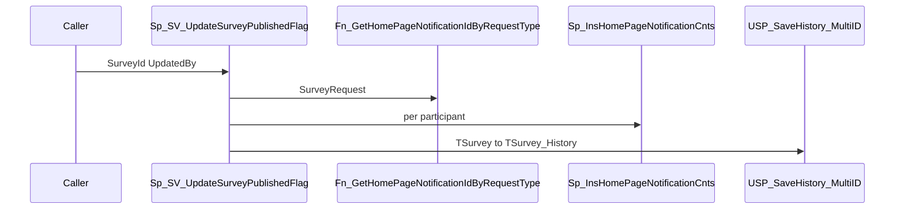
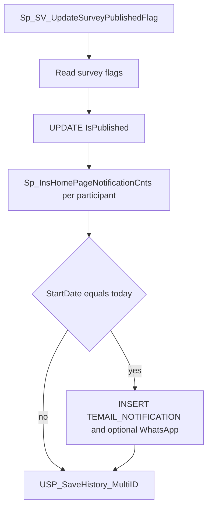

# Sp_SV_UpdateSurveyPublishedFlag

## What it does

Marks a survey published (`IsPublished = 1`), bumps home-page notification counts for each participant, queues email (and optional WhatsApp) when the survey start date is today, and copies the survey row into history.

## Parameters

| Name | Direction | What it is for |
|---|---|---|
| `@pSurveyId` | in | Survey to publish |
| `@pUpdatedBy` | in | Employee id stored on `EditedBy` and history |

## Call sequence

## Callers

No other procedure or function calls this object. Application caller: Survey API `surveyDAL.UpdateSurveyPublishedFlag` from Survey List Publish.

| Object | Kind | Page |
|---|---|---|
| — | — | No SQL callers |

## Nested

| Object | Kind | When | Page |
|---|---|---|---|
| `Fn_GetHomePageNotificationIdByRequestType` | function | always (notification id) | [Fn_GetHomePageNotificationIdByRequestType](/docs/database/hrms/Fn_GetHomePageNotificationIdByRequestType) |
| `Sp_InsHomePageNotificationCnts` | procedure | once per participant | [Sp_InsHomePageNotificationCnts](/docs/database/hrms/Sp_InsHomePageNotificationCnts) |
| `USP_SaveHistory_MultiID` | procedure | after publish update | [USP_SaveHistory_MultiID](/docs/database/hrms/USP_SaveHistory_MultiID) |

## Steps

1. Script is `HRMS-DATABASE/HRMS-SURVEY/STOREPROCEDURE/Sp_SV_UpdateSurveyPublishedFlag.sql`.
2. Read `IsConfidential`, `StartDate`, and `EmployerId` from `TSurvey`.
3. Resolve home-page notification id via `Fn_GetHomePageNotificationIdByRequestType('SurveyRequest')`.
4. `UPDATE TSurvey` set `IsPublished = 1`, `EditedBy`, `EditedOn`.
5. Cursor over `TParticipants` for the survey; exec `Sp_InsHomePageNotificationCnts` per employee.
6. If start date equals today, insert `TEMAIL_NOTIFICATION` rows (`SR-AnonymousSurvey` or `SR-ConfidentialSurvey`) and, when MSG-MESH WhatsApp config is active for the employer, insert `TWhatsAppNotification`.
7. Exec `USP_SaveHistory_MultiID` for `TSurvey` → `TSurvey_History`.

## Tables

| Table | Read or write |
|---|---|
| `dbo.TSurvey` | read, write |
| `dbo.TParticipants` | read |
| `dbo.TEMAIL_NOTIFICATION` | write |
| `dbo.TWhatsAppNotification` | write (synonym) |
| `dbo.TSurvey_History` | write (via history proc) |
| `[MSG-MESH].dbo.MessagingClientConfig` | read |

## Flow

