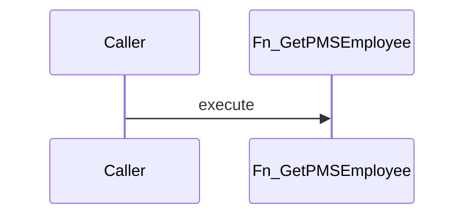
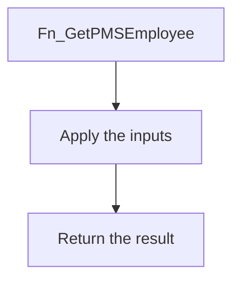

# Fn_GetPMSEmployee

## What it does

Helper called by a Home dashboard procedure. It reads TTraining, TPMS_EmployeeTrainingDetails, TPMSAppraisalCycles, TEmployee and returns that result to its caller.

## Parameters

| Name | Direction | What it is for |
|---|---|---|
| `@TrainingId` | in | Input used by this procedure (`INT`) |
| `@EmployeeId` | in | Employee the Home screen is loading or acting for (`INT`) |
| `@EmployerId` | in | Employer that owns the data (`INT`) |

## Call sequence

## Callers

| Object | Kind | Page |
|---|---|---|
| `Sp_TR_InsertTrainingAssignment` | procedure | [Sp_TR_InsertTrainingAssignment](/docs/database/hrms-training/Sp_TR_InsertTrainingAssignment) |

## Nested

This object does not execute another procedure or user-defined function.

## Steps

In `HRMS-DATABASE/HRMS-TRAINING/FUNCTIONS/Fn_GetPMSEmployee.sql`:

1. Read `TTraining`, `TPMS_EmployeeTrainingDetails`, `TPMSAppraisalCycles`, `TEmployee`, `TEmployeeInfo`, `TOrgHierarchyDetails`, `TTrainers`, `TAssignment`.
2. Return the result set to the caller.

## Tables

| Table | Read or write |
|---|---|
| `TTraining` | read |
| `TPMS_EmployeeTrainingDetails` | read |
| `TPMSAppraisalCycles` | read |
| `TEmployee` | read |
| `TEmployeeInfo` | read |
| `TOrgHierarchyDetails` | read |
| `TTrainers` | read |
| `TAssignment` | read |

## Flow

