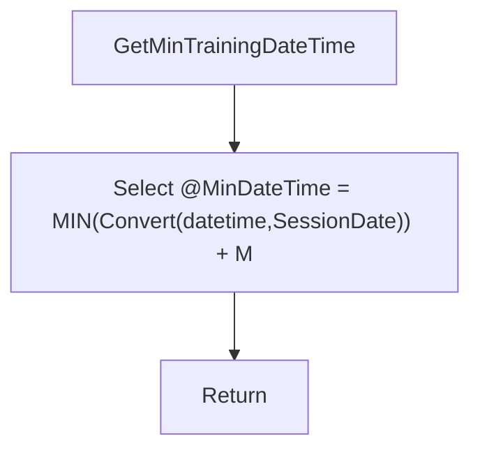

# GetMinTrainingDateTime

## What it does

User-defined function `GetMinTrainingDateTime`. Invoked from other SQL objects; see Steps and Tables for behaviour derived from the script.

## Parameters

| Name | Direction | What it is for |
|---|---|---|
| `@TrainingID` | in | Int |

## Call sequence

Calls no other procedures or functions.

## Callers

No other procedure or function calls this object.

## Nested

Calls no other procedures or functions.

## Steps

1. Script is `HRMS-DATABASE/HRMS-TRAINING/FUNCTIONS/GetMinTrainingDateTime.sql`.
2. `Select @MinDateTime = MIN(Convert(datetime,SessionDate)) + MIN(convert(datetime,StartTime)) From TTrainingSession Where TrainingID = @Traini`

## Tables

| Table | Read or write |
|---|---|
| `TTrainingSession` | read |

## Flow

