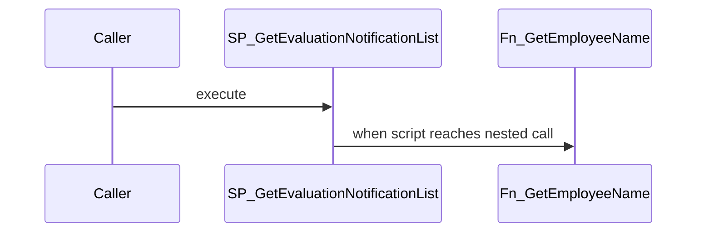
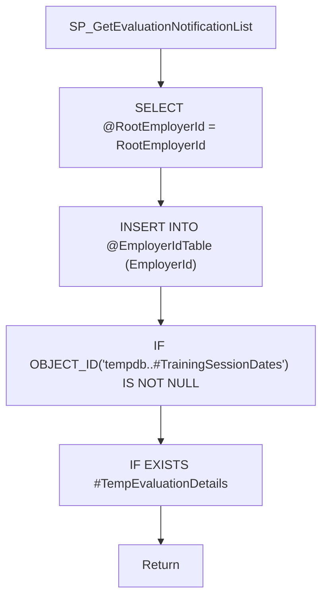

# SP_GetEvaluationNotificationList

## What it does

Stored procedure `SP_GetEvaluationNotificationList`. Calls `Fn_GetEmployeeName`. Touches `tEmployerDetails`, `STRING_SPLIT`, `TTrainingSession`, `TTrainingNotifications`, `TrainingSessionDates`, `TTrainingEvaluation`, `TTraining`, `TEmployeeInfo`.

## Parameters

| Name | Direction | What it is for |
|---|---|---|
| `@EmployeeId` | in | INT |

## Call sequence

## Callers

No other procedure or function calls this object.

## Nested

| Object | Kind | When | Page |
|---|---|---|---|
| `Fn_GetEmployeeName` | function | when script executes it | [Fn_GetEmployeeName](/docs/database/hrms/Fn_GetEmployeeName) |

## Steps

1. Script is `HRMS-DATABASE/HRMS-TRAINING/STOREPROCEDURE/SP_GetEvaluationNotificationList.sql`.
2. `SELECT @RootEmployerId = RootEmployerId`
3. `INSERT INTO @EmployerIdTable (EmployerId)`
4. `IF OBJECT_ID('tempdb..#TrainingSessionDates') IS NOT NULL`
5. `IF EXISTS #TempEvaluationDetails`

## Tables

| Table | Read or write |
|---|---|
| `tEmployerDetails` | read |
| `STRING_SPLIT` | read |
| `TTrainingSession` | read |
| `TTrainingNotifications` | read |
| `TrainingSessionDates` | read |
| `TTrainingEvaluation` | read |
| `TTraining` | read |
| `TEmployeeInfo` | read |
| `TEmployerDetails` | read |
| `TAssignment` | read |
| `TLookup` | read |

## Flow

