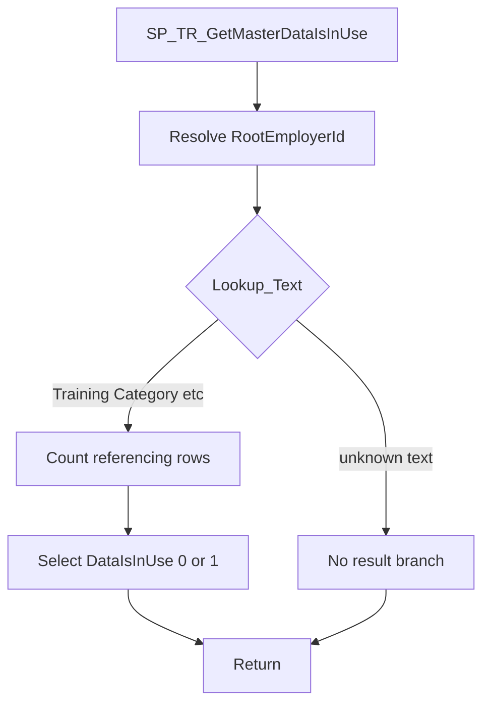

# SP_TR_GetMasterDataIsInUse

## What it does

Returns whether a Training reference row is already referenced by live data, so the UI can block edit or delete. Branches on `@Lookup_Text` (the parent type name from the grid, e.g. Training Category, Skill Level, Question Topic). Each branch counts rows in the matching training, miscellaneous, external, adhoc, waiver, evaluation, or question tables and returns `DataIsInUse` as `1` or `0`.

## Parameters

| Name | Direction | What it is for |
|---|---|---|
| `@EmployerId` | in | Employer scope for most probes |
| `@Lookup_ID` | in | Lookup id being edited or deleted |
| `@Lookup_Text` | in | Parent reference-type display name that selects the branch |

## Call sequence

Calls no other procedures or functions.

## Callers

No other procedure or function in `HRMS-TRAINING` calls this object. Application caller: Training WebAPI `GetMasterDataIsInUse`.

## Nested

Calls no other procedures or functions.

## Steps

1. Script is `HRMS-DATABASE/HRMS-TRAINING/STOREPROCEDURE/SP_TR_GetMasterDataIsInUse.sql`.
2. Resolve `@RootEmployerId` from `TEmployerDetails` for `@EmployerId` (used by the cooling-period branch).
3. Create temp table `#DataIsInUse`.
4. For each known `@Lookup_Text` value (Training Category, Training Sub-Category, Training Topics, Skill Level, Adhoc Training Category, Product, Training Source, External Source, Waiver Reason, Set Cooling Period, Question Category, Question Topic, Answer Type, Question Complexity, Question Set), count matching rows in the related table(s) and select `1` or `0` as `DataIsInUse`.
5. Branches that fill `#DataIsInUse` with a `UNION` of counts then collapse to a single `1` if any probe found usage.

## Tables

| Table | Read or write |
|---|---|
| `dbo.TEmployerDetails` | read (Training synonym to core HRMS) |
| `dbo.TLOOKUP` | read (cooling-period text lookup) |
| `dbo.TTraining` | read |
| `dbo.TMiscellaneousTrainings` | read |
| `dbo.TExternalTrainings` | read |
| `dbo.TAdhoc_Training_Request` | read |
| `dbo.TTrainingProductMapping` | read |
| `dbo.TWaiver` | read |
| `dbo.TTrainingEvaluation` | read |
| `dbo.TQuestion` | read |

## Flow

