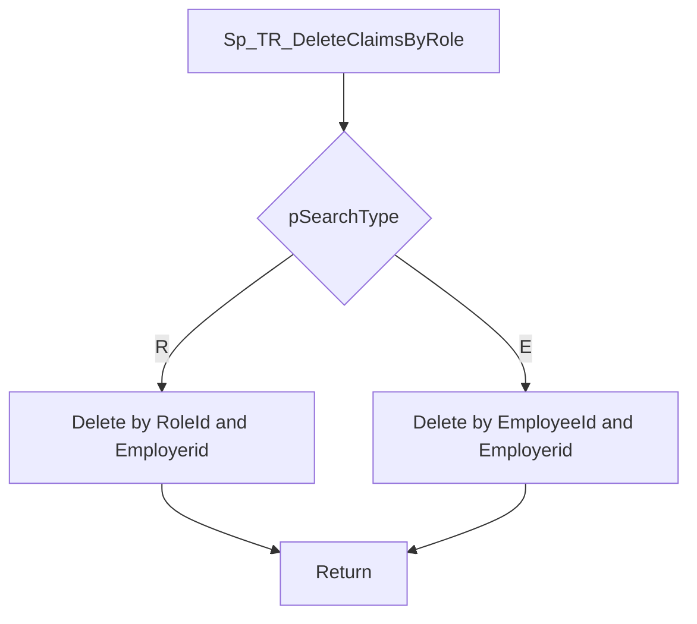

# Sp_TR_DeleteClaimsByRole

## What it does

Deletes `TCLAIM_ASSIGNMENT` rows for one employer, scoped either by role (`@pSearchType = 'R'`) or by employee (`@pSearchType = 'E'`). Training Permission Setup runs this once before re-inserting checked claims.

## Parameters

| Name | Direction | What it is for |
|---|---|---|
| `@pRoleID` | in | Role id when `@pSearchType` is `R`. Default null |
| `@pEmployerId` | in | Employer whose assignments are deleted |
| `@pSearchType` | in | `R` to match `RoleId`, `E` to match `EmployeeId` |
| `@pEmployeeId` | in | Employee id when `@pSearchType` is `E`. Default null |

## Call sequence

Calls no other procedures or functions.

## Callers

No other procedure or function calls this object. App callers: `EmployeeDAL.DeleteClaimsBySearchType` → `EmployeeBLL.InsertClaimsBySearchType` → `employeeController.InsertClaimsBySearchType` from [Training Permission Setup](/docs/guides/admin-configuration/training-permission-setup).

## Nested

Calls no other procedures or functions.

## Steps

1. Script is `HRMS-DATABASE/HRMS-TRAINING/STOREPROCEDURE/Sp_TR_DeleteClaimsByRole.sql`.
2. Delete from `TCLAIM_ASSIGNMENT` where `Employerid = @pEmployerId` and either `RoleId = @pRoleId` (`R`) or `EmployeeId = @pEmployeeId` (`E`).

## Tables

| Table | Read or write |
|---|---|
| `TCLAIM_ASSIGNMENT` | write |

## Unresolved calls

None.

## Flow

