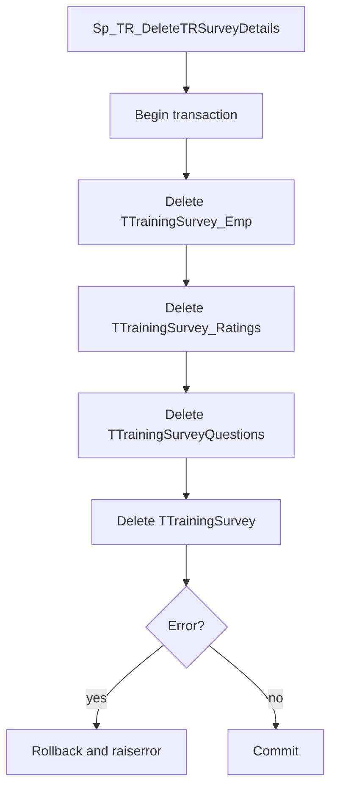

# Sp_TR_DeleteTRSurveyDetails

## What it does

Hard-deletes a training survey and its dependents in dependency order: employee answers, ratings, question links, then the survey header. Runs in a transaction; on error rolls back and `RAISERROR`s.

## Parameters

| Name | Direction | What it is for |
|---|---|---|
| `@pSurveyID` | in | `TrainingSurveyID` to remove |

## Call sequence

Calls no other procedures or functions.

## Callers

No other procedure or function calls this object.

## Nested

Calls no other procedures or functions.

## Steps

1. Script is `HRMS-DATABASE/HRMS-TRAINING/STOREPROCEDURE/Sp_TR_DeleteTRSurveyDetails.sql`.
2. `BEGIN TRANSACTION` / `BEGIN TRY`.
3. `DELETE` from `TTrainingSurvey_Emp` where `SurveyQuestionID` is in that survey’s questions.
4. `DELETE` from `TTrainingSurvey_Ratings` for `@pSurveyID`.
5. `DELETE` from `TTrainingSurveyQuestions` for `@pSurveyID`.
6. `DELETE` from `TTrainingSurvey` for `@pSurveyID`.
7. On catch: roll back if needed and `RAISERROR`.
8. `COMMIT` when `@@TRANCOUNT > 0`.

## Tables

| Table | Read or write |
|---|---|
| `TTrainingSurvey_Emp` | write |
| `TTrainingSurvey_Ratings` | write |
| `TTrainingSurveyQuestions` | read, write |
| `TTrainingSurvey` | write |

## Flow

