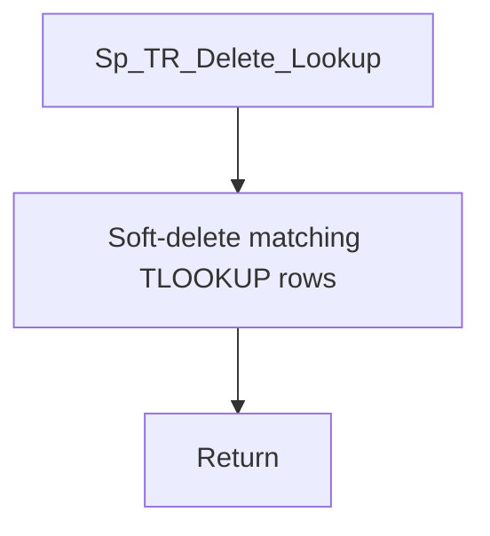

# Sp_TR_Delete_Lookup

## What it does

Soft-deletes Training lookup rows for one employer by setting `isDeleted = 1`. The target is the given `Lookup_Id`, any direct children (`Lookup_Parent_ID`), and any rows that reference it as `Sub_Parent_ID`.

## Parameters

| Name | Direction | What it is for |
|---|---|---|
| `@LookupID` | in | Lookup id to soft-delete (and related children) |
| `@pEmployerid` | in | Root employer scope (`RootEmployerid`) |

## Call sequence

Calls no other procedures or functions.

## Callers

No other procedure or function in `HRMS-TRAINING` calls this object. Application caller: Training WebAPI `DeleteLookupItem`.

## Nested

Calls no other procedures or functions.

## Steps

1. Script is `HRMS-DATABASE/HRMS-TRAINING/STOREPROCEDURE/Sp_TR_Delete_Lookup.sql`.
2. Update `TLOOKUP` set `isDeleted = 1` where `RootEmployerid = @pEmployerid` and `Lookup_Id`, `Lookup_Parent_ID`, or `Sub_Parent_ID` equals `@LookupID`.

## Tables

| Table | Read or write |
|---|---|
| `dbo.TLOOKUP` | write |

## Flow

