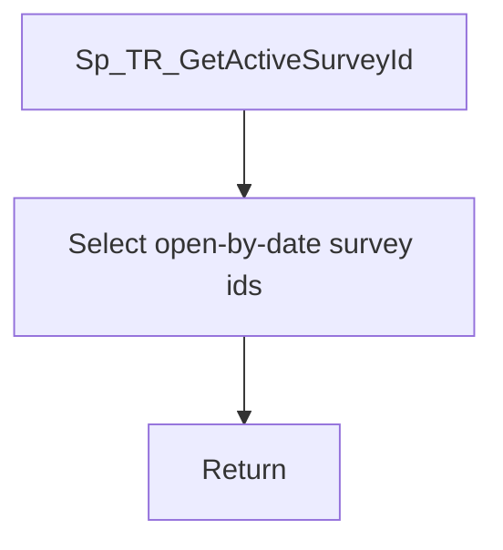

# Sp_TR_GetActiveSurveyId

## What it does

Returns `TrainingSurveyID` values for an employer whose `OpenTill` date is still on or after UTC today. Does **not** filter `IsPublished`. No `ORDER BY` — multiple open surveys return as an unordered set; the SPA uses the first row.

## Parameters

| Name | Direction | What it is for |
|---|---|---|
| `@pEmployerId` | in | Employer to search |

## Call sequence

Calls no other procedures or functions.

## Callers

No other procedure or function calls this object.

## Nested

Calls no other procedures or functions.

## Steps

1. Script is `HRMS-DATABASE/HRMS-TRAINING/STOREPROCEDURE/Sp_TR_GetActiveSurveyId.sql`.
2. `SET NOCOUNT ON`.
3. `SELECT TrainingSurveyID FROM TTrainingSurvey` where `OpenTill` date ≥ UTC today and `EmployerId = @pEmployerId`.

## Tables

| Table | Read or write |
|---|---|
| `TTrainingSurvey` | read |

## Flow

