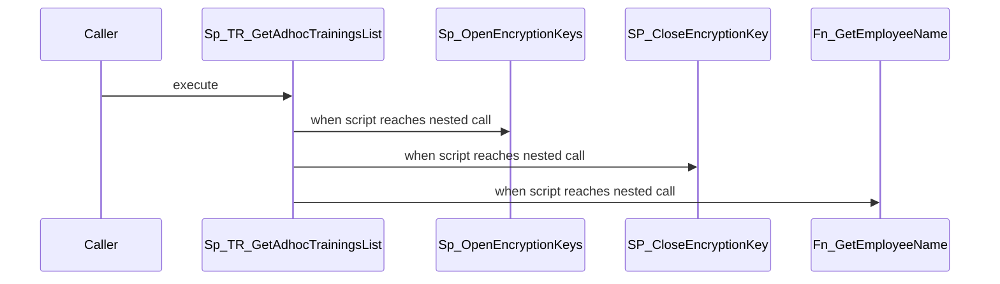
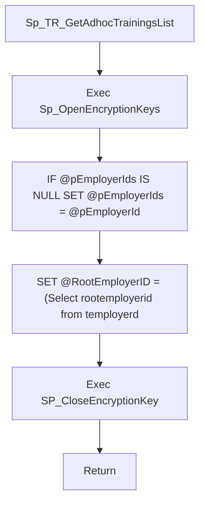

# Sp_TR_GetAdhocTrainingsList

## What it does

Stored procedure `Sp_TR_GetAdhocTrainingsList`. Calls `Sp_OpenEncryptionKeys`, `SP_CloseEncryptionKey`, `Fn_GetEmployeeName`. Touches `temployerdetails`, `String_Split`, `TLookup`, `TOrgHierarchyDetails`, `STRING_SPLIT`, `TAdhoc_Training_Request`.

## Parameters

| Name | Direction | What it is for |
|---|---|---|
| `@pEmployerId` | in | INT |
| `@pEmployerIds` | in | VARCHAR(MAX) |

## Call sequence

## Callers

No other procedure or function calls this object.

## Nested

| Object | Kind | When | Page |
|---|---|---|---|
| `Sp_OpenEncryptionKeys` | procedure | when script executes it | [Sp_OpenEncryptionKeys](/docs/database/hrms/Sp_OpenEncryptionKeys) |
| `SP_CloseEncryptionKey` | procedure | when script executes it | [SP_CloseEncryptionKey](/docs/database/hrms/SP_CloseEncryptionKey) |
| `Fn_GetEmployeeName` | function | when script executes it | [Fn_GetEmployeeName](/docs/database/hrms/Fn_GetEmployeeName) |

## Steps

1. Script is `HRMS-DATABASE/HRMS-TRAINING/STOREPROCEDURE/Sp_TR_GetAdhocTrainingsList.sql`.
2. `Exec Sp_OpenEncryptionKeys`
3. `IF @pEmployerIds IS NULL SET @pEmployerIds = @pEmployerId`
4. `SET @RootEmployerID = (Select rootemployerid from temployerdetails where employerid = (`
5. `Exec SP_CloseEncryptionKey`

## Tables

| Table | Read or write |
|---|---|
| `temployerdetails` | read |
| `String_Split` | read |
| `TLookup` | read |
| `TOrgHierarchyDetails` | read |
| `STRING_SPLIT` | read |
| `TAdhoc_Training_Request` | read |

## Flow

