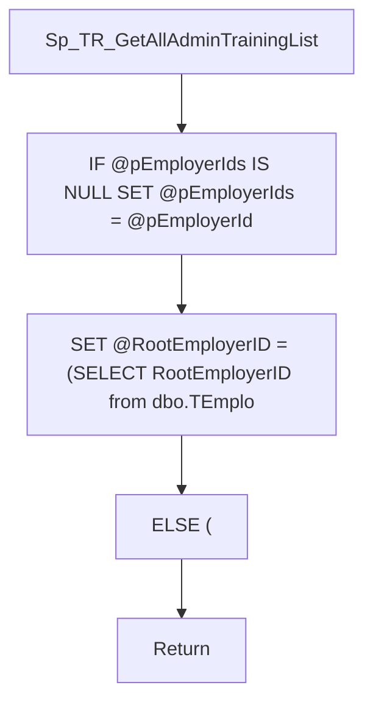

# Sp_TR_GetAllAdminTrainingList

## What it does

Stored procedure `Sp_TR_GetAllAdminTrainingList`. Calls no other procedure or function. Touches `TEmployerDetails`, `STRING_SPLIT`, `TLOOKUP`, `TTrainers`, `TTrainingDocuments`, `TTrainingSession`, `TTraining`.

## Parameters

| Name | Direction | What it is for |
|---|---|---|
| `@pEmployerId` | in | VARCHAR(5000) |

## Call sequence

Calls no other procedures or functions.

## Callers

No other procedure or function calls this object.

## Nested

Calls no other procedures or functions.

## Steps

1. Script is `HRMS-DATABASE/HRMS-TRAINING/STOREPROCEDURE/Sp_TR_GetAllAdminTrainingList.sql`.
2. `IF @pEmployerIds IS NULL SET @pEmployerIds = @pEmployerId`
3. `SET @RootEmployerID = (SELECT RootEmployerID from dbo.TEmployerDetails WHERE employerid =`
4. `ELSE (`

## Tables

| Table | Read or write |
|---|---|
| `TEmployerDetails` | read |
| `STRING_SPLIT` | read |
| `TLOOKUP` | read |
| `TTrainers` | read |
| `TTrainingDocuments` | read |
| `TTrainingSession` | read |
| `TTraining` | read |

## Flow

